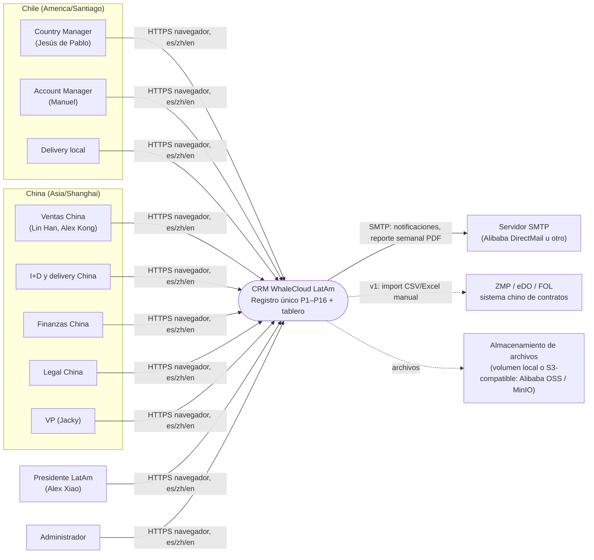
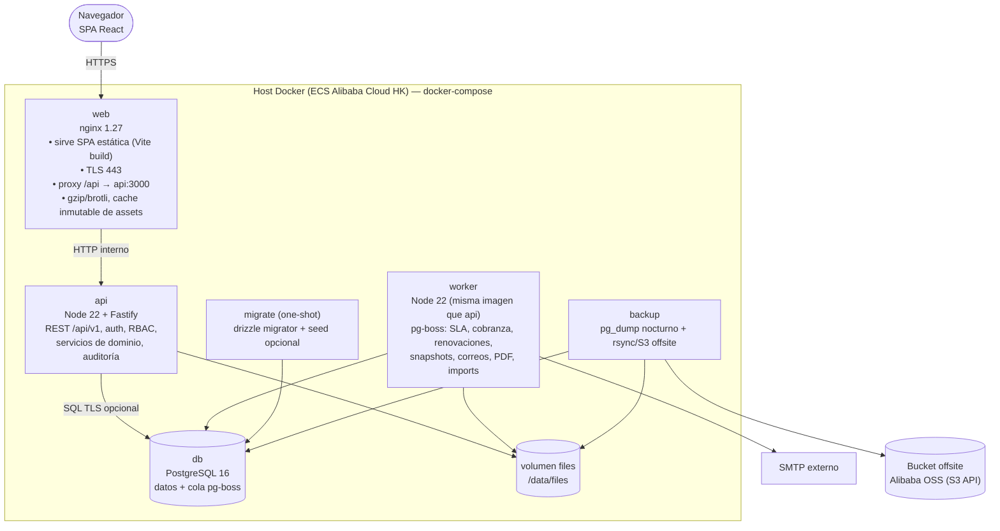
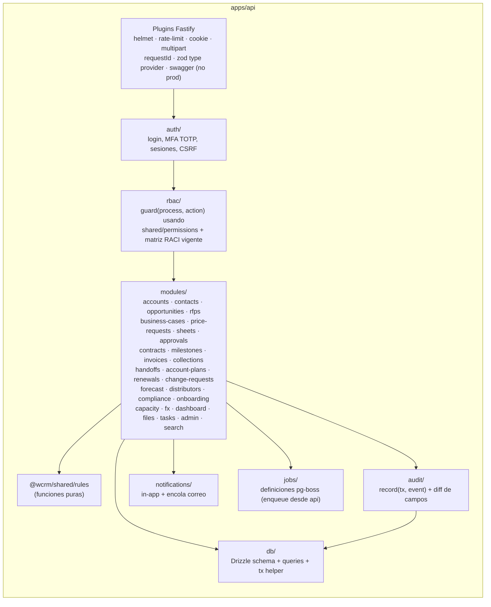
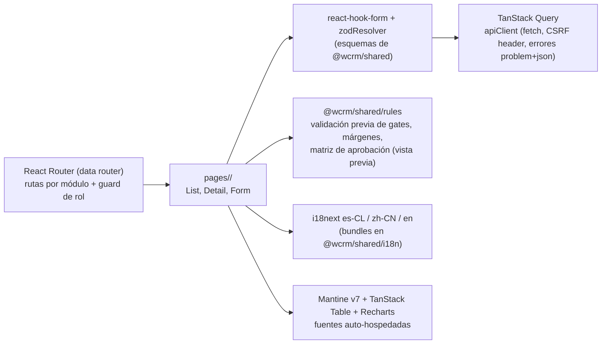
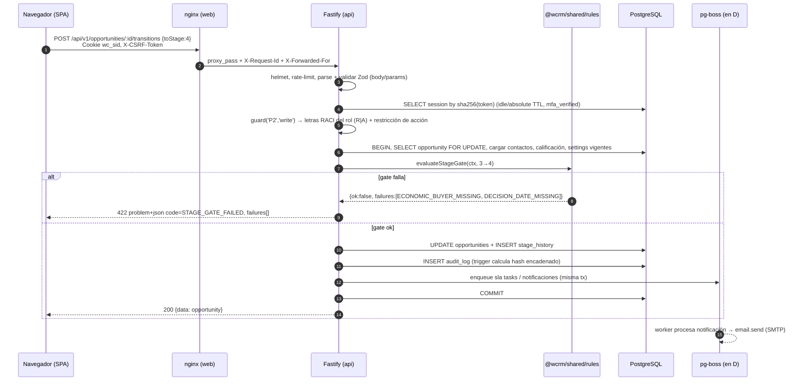
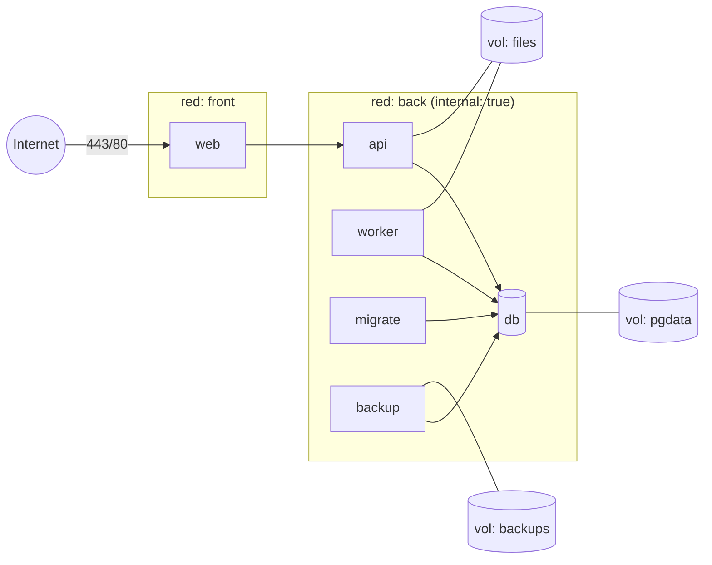

# Arquitectura — CRM WhaleCloud LatAm (Oficina Chile)

Versión 0.1 · 4 nov 2026 · Autor: Arquitecto de soluciones
Entradas: `docs/source/procesos-comerciales-whalecloud-chile.md`, `docs/product/PRD.md`, `BACKLOG.md`, `KPIS.md`.
Documentos hermanos: `DATA-MODEL.md`, `API.md`, `CONVENTIONS.md`, `adr/`.

## 0. Decisiones clave (resumen)

| Tema | Decisión | ADR |
|---|---|---|
| Base de datos | **PostgreSQL 16** | 0001 |
| Frontend | React 18 + Vite + TypeScript (SPA), Mantine v7, TanStack Query, React Router, i18next | 0002 |
| Backend | Node 22 + TypeScript + **Fastify 5**, Zod (fastify-type-provider-zod), OpenAPI generado | 0002 |
| ORM / migraciones | **Drizzle ORM + drizzle-kit** (migraciones SQL versionadas en git) | 0003 |
| Autenticación | Sesión opaca en cookie httpOnly (token hasheado en Postgres) + **MFA TOTP obligatorio**; argon2id | 0004 |
| Autorización | RBAC derivado de la matriz RACI (R/A/C/I/—) por proceso + restricciones por acción | 0004 |
| Jobs / SLA | **pg-boss** (cola y cron sobre Postgres; sin Redis) en contenedor `worker` | 0005 |
| Despliegue | docker-compose: `db`, `migrate`, `api`, `worker`, `web` (nginx: SPA + proxy `/api`), `backup`; VPS/ECS en **Alibaba Cloud Hong Kong** (sin ICP, accesible desde China y Chile) | 0005 |
| Reglas de negocio | Funciones puras en `packages/shared/src/rules` reutilizadas por web y API | 0006 |
| Incidentes eDo | Importación del `edo_incidents.json` legado (fase 1); sync directo desde el worker propuesto | 0007 |
| Correo y calendario | Solo metadatos por usuario. Fase 0: importar `crm_cache.json` del legado. Fase 1: conector local que envía los metadatos. Fase 2: Graph delegado, si los buzones pasan a Exchange Online | 0008 |
| Monorepo | npm workspaces: `apps/web`, `apps/api`, `packages/shared` | — |
| Cero dependencias externas en runtime del navegador | Sin Google Fonts, CDN, captcha, mapas ni analítica de terceros; todo se sirve desde el mismo origen | 0002, 0005 |

---

## 1. Vista de contexto (C4 nivel 1)



Restricciones de contexto:
- Usuarios en Chile y China continental **sin VPN** → el navegador solo habla con el dominio del CRM. Nada de Google (Fonts, reCAPTCHA, Analytics, Firebase), ni CDN públicos.
- La planilla comercial de China **no se reemplaza**: se adjunta por versión y se registran sus salidas por partida (PRD §5).
- Sin integraciones automáticas en v1 (ADM-14 = W): ZMP/eDO/FOL entran por importación de archivos.

## 2. Vista de contenedores (C4 nivel 2)



| Contenedor | Imagen | Puertos | Responsabilidad |
|---|---|---|---|
| `web` | `ghcr.io/whoismanib/whalecloud-crm-web` (nginx:1.27-alpine + `dist/`) | 80, 443 (único expuesto) | SPA, TLS, proxy inverso, cabeceras de seguridad estáticas |
| `api` | `ghcr.io/whoismanib/whalecloud-crm-api` (node:22-alpine) | 3000 (interno) | HTTP API, validación Zod, autenticación, RBAC, reglas, auditoría |
| `worker` | misma imagen que `api`, `CMD node dist/worker.js` | — | Jobs programados y asíncronos (pg-boss) |
| `migrate` | misma imagen que `api`, `CMD node dist/migrate.js` | — | Aplica migraciones antes de levantar `api`/`worker` (`depends_on: condition: service_completed_successfully`) |
| `db` | `postgres:16-alpine` | 5432 (interno; en dev se expone) | Datos, cola de jobs, bitácora inmutable |
| `backup` | `postgres:16-alpine` + script cron | — | Respaldos (ver §14) |
| `mailpit` (solo dev) | `axllent/mailpit` | 8025 | Captura de correos en desarrollo |

## 3. Vista de componentes (C4 nivel 3)

### 3.1 API (`apps/api`)



Patrón por módulo (`apps/api/src/modules/<modulo>/`):
- `routes.ts` — declara rutas, esquemas Zod de `@wcrm/shared/schemas`, `preHandler: [requireAuth, guard('P5','write')]`.
- `service.ts` — lógica de aplicación: abre transacción, carga agregados, llama reglas puras, persiste, llama `audit.record`, encola jobs/notificaciones. **Toda escritura pasa por un service.**
- `repo.ts` — consultas Drizzle (sin lógica de negocio).
- `*.test.ts` — integración con Supertest contra Postgres real.

### 3.2 Web (`apps/web`)



La SPA usa las mismas reglas que la API para **mostrar** bloqueos antes de enviar (ej. "faltan: comprador económico, fecha de decisión"), pero la API **siempre** re-evalúa: el front nunca es fuente de verdad.

### 3.3 Worker (`apps/api/src/worker.ts`)

| Job (pg-boss) | Cron (zona) | Qué hace | Historias |
|---|---|---|---|
| `sla.scan` | cada hora `0 * * * *` | Recalcula vencimientos de tareas SLA (P1 48 h, P3 decisión 2 d / hito interno, P5 10/5 d, P6 3 d, P7 Legal 5 d / repositorio 2 d, P8 AC 10 d / factura 1 d, P9 5 d); crea alertas "por vencer" (1 día hábil antes) y "vencido" | P1-02, P3-01, P5-03, P6-04, P7-04/05, P8-01/04, P9-01, ADM-11 |
| `collections.daily` | 08:00 America/Santiago | Genera acciones −10/+1/+7/+15/+30 para facturas con saldo > 0 | P8-06 |
| `renewals.daily` | 07:00 America/Santiago | Crea oportunidad de renovación a T−90; alerta T−60 sin propuesta | P10-03/04 |
| `approvals.expiry` | 00:30 America/Santiago | Marca aprobaciones vencidas (60 días) | P6-05 |
| `forecast.monday` | lun 18:00 Santiago | Lista de oportunidades sin actualizar al AM y CM | P12-02 |
| `forecast.snapshot` | mié 09:00 Santiago | Congela snapshot semanal y KPIs | P12-03 |
| `reviews.quarterly` | 1 de ene/abr/jul/oct 08:00 | Revisiones de cuenta atrasadas | P10-02 |
| `onboarding.daily` | 08:00 | Personas > 30 días con ítems pendientes | P15-01 |
| `fx.recalc` | evento (al cargar TC del mes) | Recalcula equivalentes de montos marcados `fx_provisional` | CORE-04 |
| `email.send` | evento | Envía correo SMTP en el idioma del destinatario | ADM-11 |
| `report.weekly.pdf` | evento | Genera PDF (pdfmake + Noto Sans SC embebida) y envía | P12-04 |
| `import.process` | evento | Importa CSV/Excel (cuentas, oportunidades, contratos, hitos, horas ZMP) | CORE-08, P16-01 |
| `audit.verify` | 03:00 diario | Verifica la cadena de hashes de la bitácora; alerta si se rompe | ADM-10 |
| `sessions.cleanup` | 04:00 diario | Elimina sesiones expiradas | — |

Todos los jobs son **idempotentes** (clave única `job_key` por entidad+fecha, p. ej. `collections:<invoice_id>:+7`), con reintento exponencial (3 intentos).

## 4. Módulos por proceso

| Proceso | Módulo API | Pantallas web | Entidades principales | Reglas compartidas usadas |
|---|---|---|---|---|
| CORE | `accounts`, `contacts`, `opportunities`, `files`, `search`, `imports` | Cuentas, Contactos, Oportunidades (lista/kanban/detalle), Búsqueda global, Importar | `accounts`, `contacts`, `opportunities`, `stage_history`, `attachments` | `stageGates`, `fx`, `naming`, `derivedStage` |
| P1 Prospección | `opportunities` (alta), `activities` | Alta rápida cuenta+contacto+oportunidad | `opportunities`, `activities` | `businessDays` (SLA 2 d), `stageGates` |
| P2 Calificación | `opportunities/qualification` | Pestaña BANT/MEDDPICC; vista revisión semanal | `opportunity_qualifications` | `qualification.meddpiccScore`, `stageGates` |
| P3 Preventa | `rfps` | RFI/RFP, matriz de cumplimiento, demos | `rfps`, `rfp_requirements`, `activities` | `businessDays.subtractBusinessDays` (hito interno) |
| P4 Caso de negocio | `business-cases` | Formulario una página (cliente/aprobador) | `business_cases` | `businessCase.isRequired` |
| P5 Solicitud de precio | `price-requests`, `sheets` | Ficha A1 + 4 datos, estado, hilo Q&A, estimaciones, versiones de planilla | `price_requests`, `price_request_expected_milestones`, `price_request_messages`, `cost_estimates`, `sheet_versions`, `sheet_line_items`, `sheet_milestones` | `priceRequest.validateA1`, `milestones.sumTo100`, `slaClock` |
| P6 Aprobación | `approvals` | Vista previa de matriz, bandeja del aprobador, decisión | `approval_requests`, `approval_steps`, `approval_delegations` | `margins`, `approvalMatrix`, `nonEconomicConditions` |
| P7 Propuesta y contrato | `proposals`, `contracts`, `legal-reviews` | Generar propuesta, comparar flujo vs T&C, contratos, revisión Legal | `proposals`, `contracts`, `legal_reviews` | `milestones.compareCashflowVsTc`, `stageGates` (5, 7), `naming` |
| P8 Hito a cobro | `milestones`, `invoices`, `payments`, `collections` | Hitos, evidencia, paquete a Finanzas, facturas, pagos, cobranza | `milestones`, `milestone_billing_lines`, `invoices`, `payments`, `collection_actions` | `evidence.requiredByEngine`, `collections.schedule`, `derivedStage` |
| P9 Traspaso | `handoffs` | Reunión de traspaso, criterios, calendario de hitos | `handoffs` | `businessDays`, `stageGates` (8) |
| P10 Cuentas y renovaciones | `account-plans`, `account-reviews`, `renewals` | Plan anual, revisiones, calendario de renovaciones | `account_plans`, `account_reviews`, `renewals` | `renewals.schedule` |
| P11 CRs | `change-requests`, `rate-cards` | CR, cotización por perfil, excepción CM | `change_requests`, `change_request_lines`, `rate_cards` | `cr.quote`, `cr.canStartWork` |
| P12 Pronóstico | `forecast` | Revisión martes, snapshots, reporte semanal | `forecast_snapshots`, `forecast_snapshot_items`, `kpi_snapshots` | `forecast.categoryConsistency`, `coverage`, `forecast.accuracy` |
| P13 Distribuidores | `distributors` | Distribuidores, acuerdos, registro de oportunidades, conflicto, capacitaciones | `distributors`, `distributor_agreements`, `deal_registrations`, `distributor_trainings` | `channelConflict.detect` |
| P14 Cumplimiento | `compliance` | Checklist por oportunidad, hallazgos, solicitudes Ley 21.719 | `compliance_checklists`, `compliance_items`, `audit_findings`, `data_subject_requests` | `compliance.requiredSections` |
| P15 Incorporación | `onboarding` | Checklist por persona, biblioteca de plantillas | `onboarding_checklists`, `onboarding_items`, `templates` | `businessDays` |
| P16 Capacidad residente | `capacity` | Import horas ZMP, consumo por OC, proyección | `resident_pos`, `hours_imports`, `hours_entries` | `capacity.consumption` |
| Tablero | `dashboard` | 10 KPIs, embudo post-venta, KPIs por proceso, drill-down, export | vistas SQL + `kpi_snapshots` | `kpis.*`, `coverage`, `fx` |
| ADM | `auth`, `users`, `admin` | Usuarios, RACI, parámetros, calendarios, catálogos, delegaciones, bitácora | `users`, `user_roles`, `sessions`, `raci_versions`, `raci_entries`, `settings`, `calendars`, `holidays`, catálogos, `audit_log` | `permissions` |

## 5. Flujo de una petición



Convenciones del flujo:
- Una transacción por comando; `SELECT … FOR UPDATE` sobre la raíz del agregado (oportunidad, hito, factura) para evitar carreras en gates.
- pg-boss se usa con la misma conexión transaccional (`boss.send(..., { db: txAdapter })`) para que el job exista **solo si** el commit ocurre.
- Lecturas de listas: sin transacción explícita; filtros de visibilidad RBAC aplicados en SQL (§6.4).

## 6. Autenticación y RBAC

### 6.1 Autenticación (ADM-01)

1. `POST /auth/login {email, password}` → verifica argon2id; si OK crea sesión **parcial** (`mfa_verified=false`) y responde `{mfaRequired:true, enrolled:bool}`.
2. Si no está enrolado: `POST /auth/mfa/setup` → secreto TOTP (RFC 6238, 30 s, 6 dígitos, `otplib`) + URI `otpauth://` (QR generado en el navegador con librería local, sin servicios externos) → `POST /auth/mfa/verify {code}`.
3. `POST /auth/mfa/verify` → sesión completa (`mfa_verified=true`). Se entregan 10 códigos de recuperación (hash argon2id) en el primer enrolamiento.
4. Cookie `wc_sid`: token aleatorio de 32 bytes (base64url), `HttpOnly; Secure; SameSite=Lax; Path=/`. En BD solo `sha256(token)`.
5. Expiración: inactividad 12 h, absoluta 7 días (⚙ `auth.sessionIdleHours`, `auth.sessionAbsoluteDays`). Logout borra la fila. Desactivar usuario (ADM-12) borra todas sus sesiones.
6. CSRF: cookie no-httpOnly `wc_csrf` (aleatoria) + cabecera `X-CSRF-Token` obligatoria en métodos no seguros (double submit) además de `SameSite=Lax`.
7. Bloqueo: 10 intentos fallidos por cuenta → bloqueo 15 min; todos los intentos quedan en bitácora (`LOGIN_FAILED`).
8. Reset de contraseña: token de un uso (sha256 en BD, 30 min) por correo; Admin puede reiniciar MFA de un usuario (queda en bitácora).

Política de contraseñas: mínimo 12 caracteres, verificación contra lista local de contraseñas comunes (top 10k, empaquetada), sin reglas de composición forzadas (NIST 800-63B).

### 6.2 Roles

| Rol (enum `user_role`) | Persona(s) | Ubicación | Calendario/zona por defecto |
|---|---|---|---|
| `COUNTRY_MANAGER` | Jesús de Pablo | Chile | CL · America/Santiago |
| `ACCOUNT_MANAGER` | Manuel | Chile | CL · America/Santiago |
| `CHINA_SALES` | Lin Han, Alex Kong | China | CN · Asia/Shanghai |
| `CHINA_DELIVERY` | I+D y delivery China | China | CN · Asia/Shanghai |
| `LOCAL_DELIVERY` | Delivery local | Chile | CL · America/Santiago |
| `CHINA_FINANCE` | Finanzas China | China | CN · Asia/Shanghai |
| `CHINA_LEGAL` | Legal China | China | CN · Asia/Shanghai |
| `VP` | Jacky | China | CN · Asia/Shanghai |
| `LATAM_PRESIDENT` | Alex Xiao | — | CL · America/Santiago (configurable) |
| `ADMIN` | Designado por CM | Chile | CL |

Un usuario puede tener varios roles (`user_roles`); los permisos son la **unión**. El "Comité de precios China" no es un usuario: su decisión la **registra** `CHINA_SALES` adjuntando el acta (paso `COMMITTEE` de la aprobación).

### 6.3 Matriz RACI por defecto (seed de `raci_entries`, versión 1; editable por ADMIN, ADM-03)

Fuente: matriz de responsables del documento fuente (P1–P10, P12) y PRD §3 (P11, P13–P16). `DASH` y `ADM` son procesos técnicos.

| Proceso | CM | AM | CHINA_SALES | CHINA_DELIVERY | LOCAL_DELIVERY | CHINA_FINANCE | CHINA_LEGAL | VP | LATAM_PRESIDENT | ADMIN |
|---|---|---|---|---|---|---|---|---|---|---|
| P1 | A | R | C | — | — | — | — | — | I | C |
| P2 | A | R | C | — | — | — | — | — | I | C |
| P3 | A | R | R | C | C | — | C | — | I | C |
| P4 | A | R | C | C | — | C | — | — | — | C |
| P5 | C | R | R | R | C | C | — | I | I | C |
| P6 | C | R | C | — | — | C | — | A* | A* | C |
| P7 | A | R | C | C | — | C | R | — | I | C |
| P8 | A | R | C | C | R | R | C | — | I | C |
| P9 | A | R | C | R | R | I | — | — | — | C |
| P10 | A | R | C | C | C | I | — | — | I | C |
| P11 | A | R | R | C | C | I | — | — | — | C |
| P12 | R/A | R | C | — | — | C | — | I | I | C |
| P13 | A | R | C | — | — | C | C | — | I | C |
| P14 | A | R | C | — | — | — | R | — | I | C |
| P15 | R/A | C | C | — | — | — | — | — | I | C |
| P16 | A | R | — | — | R | I | — | — | — | C |
| DASH | A | R | I | I | I | I | I | I | I | C |
| ADM | C | — | — | — | — | — | — | — | — | R/A |

\* P6: la letra A habilita aprobar, pero **qué** aprobador corresponde lo decide `approvalMatrix` por banda (VP banda 50–60 %; LATAM_PRESIDENT banda 60 %–objetivo y condiciones no económicas; VP informa/CONSULTA según ⚙ `approval.presidentCoApprovesVpBand`). ADMIN tiene C en procesos de negocio para soporte y reasignación (ADM-12), **nunca** A en negocio.

### 6.4 Derivación de permisos

Implementado en `packages/shared/src/permissions.ts` (puro) y aplicado en `apps/api/src/rbac/guard.ts`.

```ts
type Letter = 'R' | 'A' | 'C' | 'I';
type Action = 'view' | 'comment' | 'write' | 'approve' | 'notify';
// R → view, comment, write          A → view, comment, write, approve, notify
// C → view, comment                 I → view, notify          — → nada
can(roles, process, action, raci): boolean
```

**Restricciones por acción** (además de la letra; tabla `ACTION_ROLES` en shared, no editable en v1):

| Acción | Roles permitidos (además de cumplir letra) |
|---|---|
| `P5.a1.write`, `P5.submit` | ACCOUNT_MANAGER, COUNTRY_MANAGER |
| `P5.costEstimate.write` | CHINA_DELIVERY, CHINA_SALES |
| `P5.sheetVersion.write` | CHINA_SALES |
| `P6.committee.record` | CHINA_SALES |
| `P6.step.decide` | el `assignee_role` del paso (o delegado vigente, ADM-04) |
| `P7.legalReview.decide` | CHINA_LEGAL |
| `P8.evidence.write`, `P8.milestone.ready` | ACCOUNT_MANAGER, LOCAL_DELIVERY |
| `P8.invoice.write`, `P8.payment.write` | CHINA_FINANCE |
| `P8.collection.action` | rol responsable de la acción (AM −10/+1; CM +7/+15; CHINA_FINANCE/CHINA_LEGAL +30) |
| `P11.exception`, `P8.suspendAccount`, `P13.conflict.decide`, `P14.checklist.approve` | COUNTRY_MANAGER |
| `P14.checklist.review` | CHINA_LEGAL |
| `P16.hours.import` | LOCAL_DELIVERY, ADMIN |
| `FX.write` | CHINA_FINANCE, ADMIN |
| `ADM.*` | ADMIN |

**Visibilidad de registros** (ADM-02: "Legal China no ve una oportunidad en etapa 0"): `canViewOpportunity(roles, opp, raci)` mapea la etapa actual a un proceso y exige letra ≠ — en él, **o** que el usuario tenga una asignación explícita (tarea, paso de aprobación, revisión legal) sobre la oportunidad.

| Etapa | 0 | 1 | 2–3 | 4 | 5–6 | 7 | 8 | 9–11 | cerrada |
|---|---|---|---|---|---|---|---|---|---|
| Proceso | P1 | P2 | P3 | P5 | P6/P7 | P7 | P9 | P8 | último proceso |

En SQL se traduce a `WHERE stage = ANY(:visibleStages) OR id IN (SELECT opportunity_id FROM assignments WHERE user_id=:me)`. Además, filtro por país: `country_code = ANY(user.country_codes)` (China, VP, presidente y ADMIN: todos los países).

**Versionado**: cada cambio de RACI crea `raci_versions(n+1)`; el guard usa la versión `is_active`. Se cachea en memoria del proceso API 60 s (invalidación por `NOTIFY raci_changed`).

## 7. Bitácora inmutable (audit log, ADM-10)

Equivalente a la pestaña 修改记录. Diseño:

1. **Tabla única** `audit_log` (ver `DATA-MODEL.md` §4.19), `id bigserial`, append-only.
2. **Escritura desde la aplicación**, en la **misma transacción** que el cambio (`audit.record(tx, {...})`), con actor, rol efectivo, delegación (`on_behalf_of_user_id`), `request_id`, IP, user-agent, motivo y `changes` (`[{field, old, new}]` calculado por `diffFields(before, after, fieldList)`).
3. **Inmutabilidad en tres capas**:
   - Permisos: el rol de BD de la app (`wcrm_app`) tiene `INSERT, SELECT` sobre `audit_log` y **no** `UPDATE/DELETE/TRUNCATE`. Las migraciones corren con `wcrm_owner`.
   - Trigger `audit_log_immutable` `BEFORE UPDATE OR DELETE` y `BEFORE TRUNCATE` → `RAISE EXCEPTION 'audit_log is append-only'` (protege incluso al owner salvo `DROP TRIGGER`, que queda en logs de Postgres).
   - **Cadena de hashes**: trigger `BEFORE INSERT` toma `pg_advisory_xact_lock(42)`, lee el `hash` del último registro y calcula `hash = sha256(prev_hash || canonical_json(row))`. Job `audit.verify` diario recorre la cadena; `GET /audit-log/verify` para Admin.
4. **Datos personales** (Ley 21.719): campos PII de contactos (`email`, `phone`, `mobile`, `notes`) se registran como `"[PII]"` en `changes`, de modo que una anonimización (P14-04) **no requiere** tocar la bitácora.
5. **Categorías** para filtrar la cronología (ADM-10): `PRICE`, `SCOPE`, `STAGE`, `APPROVAL`, `EXCEPTION`, `CONTRACT`, `BILLING`, `COLLECTION`, `SECURITY`, `CONFIG`, `DATA`, `EXPORT`.
6. Qué se registra siempre: CREATE/UPDATE de entidades de negocio (campos clave), cambio de etapa, decisiones de aprobación, excepciones (CR sin OC, override de bandera digital, suspensión), cambios de parámetros/RACI/TC, login/logout/fallos/MFA reset, exportaciones (DASH-08) e importaciones, subidas de archivos, anonimizaciones.
7. Retención: indefinida. Particionado no necesario en v1 (< 1 M filas/año estimadas); índice por `(entity_type, entity_id, occurred_at)` y `(opportunity_id, occurred_at)`.

## 8. Motor de reglas de negocio (`packages/shared/src/rules`)

Principios: **funciones puras**, deterministas, sin I/O, sin `Date.now()` (la fecha "hoy" se recibe como parámetro), parámetros configurables entran como argumento `settings` tipado (Zod) — así el front muestra lo mismo que la API valida y los tests son triviales. Aritmética monetaria con `decimal.js` (montos viajan como string decimal).

| Archivo | Funciones (firma resumida) | Historias | Casos de prueba obligatorios |
|---|---|---|---|
| `margins.ts` | `priceFromCost(cost, targetMargin)`, `netIncomeMargin(netIncome, cost)`, `contractMargin(price, cost, commercialCosts)`, `aggregateLineItems(items)` | P6-01 | Equifiber: 58,0 % y 50,3 %; software 166.640→476.114 (65 %); impl. 520.133→1.405.764 (63 %); L3 434.688→2.120.428 (79,5 %) |
| `approvalMatrix.ts` | `bandForLine(margin, target, thresholds) → 'COMMITTEE'\|'PRESIDENT'\|'VP'\|'NOT_QUOTABLE'`; `routeApproval(lines, conditions, settings) → {band, steps[], requiresBusinessCase, requiresCompetitiveJustification, blocked}` (manda la partida más restrictiva; base ⚙ neto/contrato) | P6-02, P6-03 | L2 63,84 % obj. 68 % → PRESIDENT; 55 % → VP + caso; 48 % → NOT_QUOTABLE; plazo pago 90 d → paso extra no económico |
| `nonEconomicConditions.ts` | `detectConditions(tc, settings) → Condition[]` (plazo > 60 d, CLP sin prima, penalidad > 10 %, responsabilidad ilimitada) con aprobador y consultado ⚙ | P6-03 | — |
| `stageGates.ts` | `evaluateStageGate(ctx, from, to, settings) → {ok, failures: GateFailure[]}`; un `GateFailure` = `{code, params}` traducible | P2-01..06, P4-01, P5-03, P7-03, P7-05, P9-02, CORE-10 | Ver tabla §8.1 |
| `derivedStage.ts` | `deriveStageFromMilestones(milestones) → 8\|9\|10\|11` (estado mínimo) | CORE-06 | 3 hitos (1 cobrado, 2 aceptados) → 9 |
| `businessDays.ts` | `isBusinessDay(date, cal)`, `addBusinessDays(date, n, cal)`, `subtractBusinessDays`, `businessDaysBetween(a, b, cal)`, `hoursToBusinessDays(h)` (48 h = 2) ; `cal = {weekend:[6,0], holidays:Set<'YYYY-MM-DD'>}` | P1-02, P3-02, P5-03... | Cierre 2026-12-01 − 5 d hábiles = 2026-11-24; feriados CL/CN |
| `slaClock.ts` | `computeSla({start, days, calendar, pauses[]}) → {dueDate, elapsed, status:'ON_TRACK'\|'DUE_SOON'\|'OVERDUE'}` (pausas por "esperando Chile") | P5-08, ADM-11 | — |
| `collections.ts` | `escalationSchedule(dueDate, settings) → [{offsetDays:-10\|1\|7\|15\|30, action, responsibleRole, notifyRoles}]`; `dueEscalations(invoice, today, existing)` (días corridos; no genera si saldo = 0) | P8-06 | Vence 2026-11-30 → 2026-12-15 = +15 (CM, notifica LATAM_PRESIDENT) |
| `evidence.ts` | `requiredEvidence(engine, milestone) → EvidenceType[]`; `canAccept(...)`, `canSendToFinance(...)` | P8-02, P8-03 | A sin AC → bloqueo; B sin OC; D sin reporte de uso |
| `milestones.ts` | `sumsTo100(list)`, `compareCashflowVsTc(cashflow, tc) → {equal, diffs[]}` | P5-02, P7-02 | 20/20/50/10 vs 30/50/20 → diffs |
| `businessCase.ts` | `isBusinessCaseRequired(amountUsd, netMargin, settings)` | P4-01 | USD 2,5 MM; 58 % |
| `qualification.ts` | `bantComplete(q)`, `meddpiccScore(q) → 0..1` (vacío 0, parcial 0,5, completo 1; promedio de 8), `meddpiccRequired(amountUsd, settings)` | P2-01/02/06 | — |
| `coverage.ts` | `weightedPipeline(opps, stageProbs, cutoff)`, `pipelineCoverage({opps, target, signedYtd, segment})`, `unweightedQualifiedCoverage` | KPI 7 | — |
| `forecast.ts` | `categoryConsistent(stage, category)`, `forecastAccuracy(actual, forecast)`, `weekOverWeekChanges(prev, curr)` | P12-01/05/06 | — |
| `fx.ts` | `convert(amount, from, to, rates)`, `resolveRate(month, currency, table) → {rate, month, provisional}` (último disponible si falta) | CORE-02/04 | Mes sin TC → provisional |
| `kpis.ts` | Fórmulas de `KPIS.md` sobre arreglos ya cargados (S&S, mezcla, payments, ingreso reconocido, profit, digital, aceptaciones pendientes, cartera vencida con tramos, tiempo de precio) | DASH-01 | — |
| `naming.ts` | `parseRepositoryName(name)`, `buildRepositoryName({country, client, type, number, version, date})` para `PAÍS_CLIENTE_TIPO_NÚMERO_VERSIÓN_FECHA` | CORE-07 | `CL_WOM_OC_4500123_v1_2026-11-04.pdf` válido |
| `renewals.ts` | `renewalDates(endDate, settings) → {createAt: T−90, quoteBy: T−60}` | P10-03/04 | Vence 2027-03-31 → crea 2026-12-31 |
| `cr.ts` | `quoteCr(lines, rateCard)`, `canStartWork(cr, today)` | P11-01/02 | 120 h × tarifa |
| `capacity.ts` | `poConsumption(hours, poHours, threshold) → {pct, alert:'NONE'\|'WARN_80'\|'CRITICAL_100', excessHours}` | P16-02 | 805/1000 → WARN_80 |
| `channelConflict.ts` | `detectConflict(accountOpenOpps, registration)` | P13-02 | — |
| `compliance.ts` | `requiredSections(opp, lines)` (export obligatorio si motor E o hardware) | P14-01 | — |
| `permissions.ts` | `can`, `canViewOpportunity`, `ACTION_ROLES` | ADM-02 | Legal no ve etapa 0; VP solo lectura en P5 |

### 8.1 Gates de etapa (resumen de `stageGates.ts`)

| Transición | Condiciones (todas) | Código de falla |
|---|---|---|
| crear (→0) | cuenta, contacto, vertical, país, origen, motor; distribuidor si origen = DISTRIBUTOR | `FIELD_REQUIRED`, `DISTRIBUTOR_REQUIRED` |
| 0→1 | dolor y patrocinador identificados; BANT completo | `PAIN_MISSING`, `SPONSOR_MISSING`, `BANT_INCOMPLETE` |
| 1→2 | BANT completo; si monto > USD 500k ⚙: MEDDPICC ≥ 50 % | `MEDDPICC_BELOW_50` |
| 2→3 | criterios de decisión documentados; MEDDPICC si monto subió (P2-06) | `DECISION_CRITERIA_MISSING` |
| 3→4 | contacto con rol ECONOMIC_BUYER + fecha de decisión; solicitud de precio enviada (A1 completa + 4 datos, hitos = 100 %) | `ECONOMIC_BUYER_MISSING`, `DECISION_DATE_MISSING`, `PRICE_REQUEST_NOT_SUBMITTED` |
| 4→5 | aprobación vigente (≤ 60 días, no invalidada); caso de negocio aprobado si aplica; condiciones no económicas aprobadas; checklist de cumplimiento aprobado; flujo de caja = T&C; validez oferta ≤ vencimiento aprobación | `APPROVAL_MISSING`, `APPROVAL_EXPIRED`, `BUSINESS_CASE_REQUIRED`, `NON_ECONOMIC_PENDING`, `COMPLIANCE_PENDING`, `CASHFLOW_TC_MISMATCH`, `OFFER_VALIDITY_EXCEEDS_APPROVAL` |
| 5→6 | (sin gate adicional; se mantiene validación de aprobación vigente) | — |
| 6→7 | contrato/OC firmado con archivo en repositorio y nombre estándar; ID sistema chino | `SIGNED_CONTRACT_MISSING`, `CHINA_SYSTEM_ID_MISSING` |
| 7→8 | traspaso registrado con asistentes LOCAL_DELIVERY y CHINA_DELIVERY; N° proyecto/OC ZMP | `HANDOFF_MISSING`, `ZMP_ID_MISSING` |
| 8→9/10/11 | **derivado** de hitos (no manual) | `STAGE_DERIVED` |
| →LOST/DISCARDED | motivo; competidor ganador si LOST | `CLOSE_REASON_REQUIRED` |
| →NOT_QUOTED | aprobación resultó NOT_QUOTABLE o decisión CM | — |

Retroceso de etapa: permitido a R/A con motivo obligatorio (queda en `stage_history` y bitácora). Saltos de más de una etapa: se evalúan todos los gates intermedios.

### 8.2 Snapshots de reglas
Cada `approval_request` guarda `rules_snapshot jsonb` (umbrales, objetivos por partida, base de margen, vigencia) usado al enrutar. Cambiar parámetros (ADM-07) afecta solo solicitudes nuevas.

## 9. Multi-moneda

- Monedas v1: `USD`, `CNY`, `CLP` (enum extensible: `COP`, `MXN`, `BOB` para réplica P15-03).
- **Tabla mensual** `fx_rates(month, currency, units_per_usd, kind ACTUAL|BUDGET)` mantenida por CHINA_FINANCE (pestaña A5). USD es pivote: `convert(x, A→B) = x / upu[A] * upu[B]`.
- Todo monto de negocio guarda: `amount`, `currency` (original) y columnas `amount_usd`, `amount_cny`, `amount_clp`, `fx_month` (`date`, primer día del mes), `fx_provisional bool`.
- Mes del evento: oportunidad → mes de `expected_close_date` mientras está abierta y mes de firma al ganar; contrato → `signed_at`; hito → mes de aceptación; factura → `issued_at`; pago → `paid_at` (KPIS.md §1).
- Mes sin TC: se usa el último disponible y `fx_provisional=true`; al cargar el TC del mes, job `fx.recalc` recalcula y registra en bitácora (CORE-04).
- Umbrales (USD 500k/2M) siempre se evalúan en `amount_usd`. KPIs en MM CNY por defecto; selector de moneda en el tablero (DASH-03). Opción `kind=BUDGET` para comparar contra meta.
- Formato: `Intl.NumberFormat(locale, {style:'currency'})`; es-CL usa `.` de miles y `,` decimal.

## 10. Internacionalización

- Locales: `es-CL` (por defecto), `zh-CN`, `en`. Preferencia en `users.locale`; detección inicial por `navigator.language`.
- Bundles JSON en `packages/shared/src/i18n/<locale>/<namespace>.json` (namespaces: `common`, `enums`, `errors`, `gates`, `emails`, `dashboard`, por módulo). Los consume la SPA (i18next + react-i18next) y la API/worker (i18next en Node) para correos, PDF y exportaciones.
- **Errores y gates viajan como códigos** (`STAGE_GATE_FAILED`, `ECONOMIC_BUYER_MISSING` + `params`); el texto se traduce en el cliente → notificaciones y mensajes en el idioma del destinatario (ADM-05).
- Enums se almacenan como códigos en inglés (`PRICE_REQUESTED`, `ENGINE_A`) y se traducen con `enums.<Enum>.<value>`.
- Fechas: se guardan en UTC (`timestamptz`) o como `date` de calendario. Visualización en `users.timezone` (America/Santiago, Asia/Shanghai) con `date-fns-tz`. SLA calculados en el calendario y zona del **responsable** (ADM-06).
- Fuentes: Inter + Noto Sans SC **auto-hospedadas** (subset WOFF2 en `apps/web/public/fonts`), sin Google Fonts. Test de CI: `npm run check:no-external` falla si el build contiene URLs `https://` a dominios distintos del propio.
- Chequeo de claves faltantes: `npm run i18n:check` compara las tres carpetas (CI).

## 11. Observabilidad

| Señal | Implementación |
|---|---|
| Logs | `pino` JSON a stdout (api, worker); `X-Request-Id` (generado por nginx o API) en cada línea; redacción de `authorization`, `cookie`, `password`, `mfaCode`; nivel por `LOG_LEVEL`. Docker `json-file` con `max-size=20m, max-file=5`. |
| Logs de acceso | nginx `log_format json` con request_id, upstream_time. |
| Métricas | `prom-client` en `GET /metrics` (solo red interna; bloqueado en nginx): latencia HTTP por ruta, errores 5xx, pool de BD, jobs pg-boss (cola, fallidos), SLA vencidos por tipo. Opcional: Prometheus + Grafana en perfil compose `monitoring`. |
| Salud | `GET /healthz` (proceso vivo), `GET /readyz` (BD + migraciones al día + pg-boss). Healthchecks docker usan estos endpoints. |
| Errores | Hook `onError` → log `error` con stack + request_id. Opcional `SENTRY_DSN` compatible con **GlitchTip auto-hospedado** (no SaaS bloqueado en China). |
| Negocio | Panel Admin "Operación": jobs fallidos, correos no enviados, verificación de bitácora, último backup OK. |
| Uptime | Chequeo externo desde Chile y China (p. ej. Uptime Kuma auto-hospedado + un sondeo desde una VM en Shanghái) sobre `/healthz`. |

## 12. Seguridad (OWASP básico)

| Riesgo OWASP Top 10 | Control |
|---|---|
| A01 Control de acceso | `guard(process, action)` obligatorio en cada ruta (test que recorre todas las rutas registradas y falla si alguna no declara guard salvo lista blanca `/auth/*`, `/healthz`); visibilidad filtrada en SQL; IDs UUID v4; tests RBAC por rol (ADM-02). |
| A02 Criptografía | TLS 1.2+ en nginx (HSTS 1 año); contraseñas **argon2id** (`@node-rs/argon2`, m=19456 KiB, t=2, p=1); secretos TOTP cifrados AES-256-GCM con `APP_ENCRYPTION_KEY`; tokens de sesión solo como sha256. |
| A03 Inyección | Drizzle con parámetros; SQL crudo solo con `sql` template etiquetado; validación Zod de body/query/params; nombres de archivo saneados. |
| A04 Diseño inseguro | Gates y matriz de aprobación en servidor; front solo pre-valida. |
| A05 Configuración | `@fastify/helmet` (CSP `default-src 'self'; img-src 'self' data: blob:; style-src 'self' 'unsafe-inline'; connect-src 'self'; frame-ancestors 'none'`), CORS deshabilitado en prod (mismo origen), Swagger UI deshabilitado en prod, contenedores no-root, `read_only` FS salvo `/data/files` y `/tmp`. |
| A06 Componentes | `npm audit --audit-level=high` y Dependabot en CI; imágenes base fijadas por versión; Trivy scan de imágenes en CI. |
| A07 Autenticación | MFA obligatorio, bloqueo por intentos, rate-limit de login (5/min por IP+email), sesiones revocables. |
| A08 Integridad | Bitácora con hash encadenado; imágenes construidas solo por CI; `npm ci` con lockfile. |
| A09 Logging | Bitácora de seguridad (login, MFA, exportaciones) + logs pino. |
| A10 SSRF | La API no hace fetch a URLs provistas por usuarios; "enlaces a repositorio" se guardan como texto y se validan como URL `https://` sin resolverlas. |

Otros:
- **Rate limit** (`@fastify/rate-limit`, almacenamiento en memoria por instancia — una réplica en v1): global 300 req/min/IP; `/auth/*` 5 req/min/IP+email; exportaciones 10/h/usuario.
- **Subida de archivos**: `@fastify/multipart`, máx. 50 MB ⚙, lista blanca de MIME/extensiones (pdf, docx, xlsx, xlsm, pptx, msg, eml, png, jpg, zip, csv), verificación de magic bytes (`file-type`), almacenamiento con nombre UUID fuera del webroot; descarga con `Content-Disposition: attachment` y `X-Content-Type-Options: nosniff`.
- **Ley 21.719**: consentimiento por contacto, solicitudes de acceso/eliminación (P14-04), anonimización, exportaciones registradas.
- **Secretos**: solo por variables de entorno / `docker secrets`; `.env` fuera de git; GitHub Environments para staging/prod.

## 13. Topología de despliegue y entornos

### 13.1 Hosting recomendado
- **Alibaba Cloud ECS región Hong Kong** (ecs.g7.large: 2 vCPU / 8 GB, disco ESSD 100 GB) con Docker. Motivo: accesible desde China continental sin VPN y **sin licencia ICP** (requerida solo para regiones de China continental); latencia aceptable desde Chile (~300 ms RTT) para una SPA con API JSON. Alternativa equivalente: cualquier VPS en Hong Kong/Singapur (o Alibaba Cloud US-West si Chile prioriza latencia; validar desde Shanghái). El diseño es portable: solo exige Docker + docker-compose.
- **Prueba de aceptación** (ADM-01): carga inicial < 5 s desde Shanghái sin VPN y desde Santiago, antes del go-live.
- Registro de imágenes: GHCR (`ghcr.io/whoismanib/...`). Si el pull desde el servidor es lento, espejo en Alibaba Container Registry (ACR) — el workflow de deploy soporta `REGISTRY` configurable.
- DNS: dominio propio (p. ej. `crm.whalecloud-latam.com`) con DNS de Alibaba Cloud; TLS con certificados Let's Encrypt emitidos por `acme.sh` en el host (validación DNS) y montados en `web`.

### 13.2 docker-compose (prod/staging)



Archivos: `docker-compose.yml` (base), `docker-compose.dev.yml` (expone 5432, añade `mailpit`, monta código), `docker-compose.prod.yml` (imágenes desde registro, límites de recursos, `restart: unless-stopped`). Ver `CONVENTIONS.md` §5.

Recursos (prod): `db` 2 GB, `api` 1 GB, `worker` 768 MB, `web` 128 MB. Una réplica de cada servicio en v1 (≤ 30 usuarios).

### 13.3 Entornos

| Entorno | Dónde | Datos | Despliegue | URL ejemplo |
|---|---|---|---|---|
| `dev` | Máquina local / agente | Seed sintético (`npm run db:seed`) | `docker compose -f docker-compose.yml -f docker-compose.dev.yml up db mailpit` + `npm run dev` | http://localhost:5173 (Vite proxy `/api` → :3000) |
| `test` (CI) | GitHub Actions | Postgres service container, BD efímera | `npm test`, Playwright contra build | — |
| `staging` | ECS HK (mismo host que prod en otro proyecto compose, o host pequeño separado) | Seed + copia anonimizada opcional | Automático en push a `main` | https://staging.crm… |
| `prod` | ECS HK | Reales | Manual: tag `v*` + aprobación en GitHub Environment `production` | https://crm… |

### 13.4 CI/CD (GitHub Actions)

| Workflow | Disparador | Jobs |
|---|---|---|
| `ci.yml` | PR y push a cualquier rama | `lint` (eslint + prettier --check) · `typecheck` (tsc -b) · `test-unit` (Vitest shared+web) · `test-api` (Vitest+Supertest con `services: postgres:16`) · `i18n:check` · `check:no-external` · `build` · `e2e` (Playwright chromium contra compose levantado) · `audit` (npm audit high) |
| `docker.yml` | push a `main` y tags `v*` | build multi-stage `api` y `web` (buildx, cache GHA), Trivy scan (falla en CRITICAL), push a GHCR con tags `sha-<7>`, `main`, `vX.Y.Z` |
| `deploy.yml` | `workflow_run` de docker.yml en `main` → staging; tag `v*` → production (environment con revisores requeridos) | SSH (`appleboy/ssh-action` o `ssh` nativo) al host: `docker compose pull && docker compose up -d` (corre `migrate` primero), smoke test `curl /readyz`; rollback = redeploy del tag anterior |

## 14. Respaldo y recuperación (ADM-13)

| Elemento | Método | Frecuencia | Retención | Destino |
|---|---|---|---|---|
| BD | `pg_dump -Fc` (contenedor `backup`, cron 02:00 America/Santiago) | Diario | 7 diarios, 4 semanales, 12 mensuales | volumen `backups` + copia offsite a bucket Alibaba OSS (S3 API, cifrado servidor) |
| Archivos | `rsync`/`aws s3 sync` de `/data/files` | Diario (incremental) | 30 días de versiones (versionado del bucket) | Alibaba OSS |
| Configuración | `.env` y certificados | Al cambiar | — | Gestor de secretos / bóveda del equipo |
| Disco | Snapshot ESSD de Alibaba | Semanal | 4 | Alibaba |

- **RPO** 24 h, **RTO** 4 h (v1). Si se exige RPO menor: WAL archiving con `wal-g` a OSS (documentado como mejora).
- **Prueba de restauración mensual**: script `scripts/restore-test.sh` restaura el último dump en un contenedor temporal y ejecuta `SELECT count(*)` + `audit.verify`; resultado al panel de operación.
- **Exportación completa por Admin** (ADM-13): `POST /admin/exports/full` → job genera ZIP (CSV por tabla + archivos) y queda en bitácora (`EXPORT`).

## 15. Rendimiento y escala esperada

- Usuarios: ~10–30; datos: < 10 k oportunidades, < 100 k filas de bitácora/año. Una instancia de cada servicio basta.
- Objetivos: p95 API < 300 ms en servidor; carga inicial SPA < 5 s desde Shanghái (bundle inicial < 300 KB gzip con code-splitting por ruta; assets con `Cache-Control: public, max-age=31536000, immutable`).
- Tablero: consultas agregadas sobre vistas SQL; si p95 > 1 s, materializar (`kpi_snapshots` diarios por el worker).

## 16. Riesgos técnicos y mitigaciones

| Riesgo | Mitigación |
|---|---|
| Latencia/bloqueo desde China | HK sin ICP, cero dominios externos en el navegador (chequeo CI), prueba real con Lin Han y Alex Kong en semana 1 |
| Correos a China caen en spam o no llegan | SMTP con SPF/DKIM/DMARC del dominio propio; notificaciones in-app como canal primario |
| Reglas cambian (umbrales, RACI sin confirmar) | Todo en `settings`/RACI versionados; reglas puras con tests de tabla |
| Un único desarrollador | Stack mínimo (sin Redis, sin microservicios), un solo lenguaje, reglas y esquemas compartidos, OpenAPI generado |
| Corrupción/borrado de bitácora | Triple protección (grants, triggers, hash chain) + backups |

## 17. Estado de implementación y desviaciones (fase 1)

Ver `docs/engineering/IMPLEMENTATION-NOTES.md`. Resumen de desviaciones deliberadas en la fase 1:
validación Zod manual en rutas (sin type provider ni OpenAPI todavía); **sin worker pg-boss**: SLA y
escalamiento se calculan al leer y las 5 acciones de cobranza se crean al emitir la factura;
archivos como **enlaces https** al repositorio con nombre estándar validado (subida binaria en fase 2);
MFA TOTP activable por `MFA_REQUIRED`; hash de bitácora canonizando `occurred_at` como epoch;
KPIs calculados en TypeScript (`rules/kpis.ts`) sin vistas SQL; compose sin `worker`/`backup`/TLS.

## 18. Estado de implementación y desviaciones (fase 2)

Worker pg-boss (`apps/api/src/worker.ts`, `npm run worker` / `dev:worker`) con el rol dueño de la BD
y esquema `pgboss`; jobs implementados: `sla.scan`, `collections.daily`, `renewals.daily`,
`capacity.daily`, `audit.verify`, `forecast.monday`, `forecast.snapshot`, `onboarding.daily`
(también ejecutables desde Administración). Notificaciones in-app con deduplicación y correo por un
`MailTransport` enchufable (`MAIL_DRIVER=console|none`; SMTP pendiente). Importaciones y exportaciones
síncronas en la API. Sin `approvals.expiry`, `reviews.quarterly`, `fx.recalc`, `email.send`,
`report.weekly.pdf` ni `import.process` como jobs. El servicio `worker` del compose de producción lo
agrega el Release Manager. Detalle en `docs/engineering/IMPLEMENTATION-NOTES.md` §3.1.
