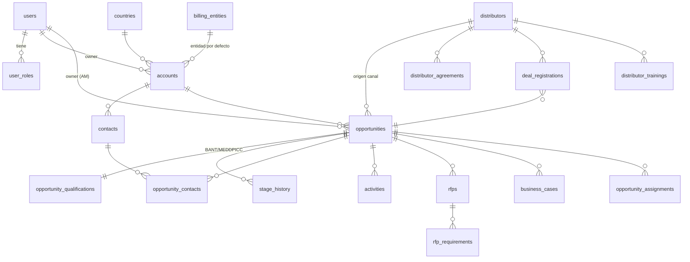
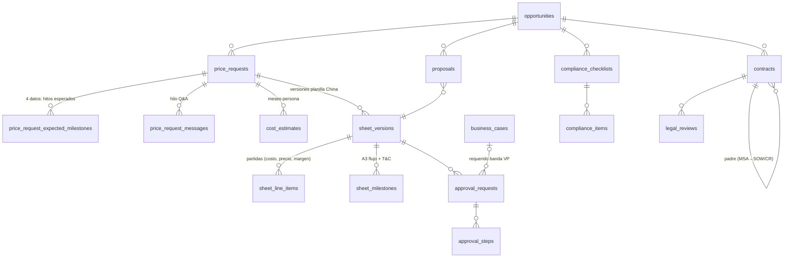
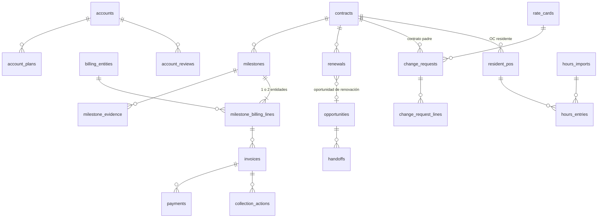
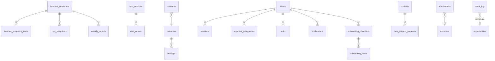

# Modelo de datos — CRM WhaleCloud LatAm (Oficina Chile)

Versión 0.1 · 4 nov 2026 · PostgreSQL 16 · ORM Drizzle (esquema en `apps/api/src/db/schema/*.ts`, migraciones SQL en `apps/api/drizzle/`).
Ver `ARCHITECTURE.md` (reglas, RBAC, bitácora) y `docs/product/KPIS.md` (fórmulas). El mapeo de nombres de campos de `KPIS.md` (español) a columnas (inglés) está en §7.

## 1. Convenciones

- Identificadores de BD y API en **inglés, snake_case** (BD) / camelCase (API/TS). Textos de UI traducidos por i18n.
- **Columnas base** (marcadas `+BASE`): `id uuid PK DEFAULT gen_random_uuid()`, `created_at timestamptz NOT NULL DEFAULT now()`, `updated_at timestamptz NOT NULL DEFAULT now()` (actualizado por la app), `created_by uuid FK users NULL`, `updated_by uuid FK users NULL`, `row_version int NOT NULL DEFAULT 1` (concurrencia optimista: la API exige `rowVersion` en PATCH y responde 409 si no coincide).
- **Grupo monetario** (marcado `+MONEY(p)` con prefijo `p`, p. ej. `amount`): `p numeric(18,2)`, `p_currency currency_code`, `p_usd numeric(18,2)`, `p_cny numeric(18,2)`, `p_clp numeric(18,0)`, `p_fx_month date` (día 1 del mes del TC usado), `p_fx_provisional boolean NOT NULL DEFAULT false`. Los equivalentes los calcula la app con `rules/fx.ts` al escribir; el job `fx.recalc` los corrige.
- Porcentajes y márgenes como **fracción** `numeric(7,6)` (0,580000 = 58 %). Porcentajes de hitos `numeric(5,2)` en puntos (30,00).
- Fechas de calendario (`date`) para vencimientos/SLA/fechas de negocio; instantes (`timestamptz`) para eventos del sistema.
- **No hay borrado físico** de datos de negocio: `archived_at timestamptz NULL` en maestros; estados `CANCELLED` en transaccionales. Excepciones: `sessions`, `password_resets`, filas de cola pg-boss.
- Extensiones: `pgcrypto` (gen_random_uuid, digest), `citext` (emails).
- Códigos legibles con secuencias: `opportunities.code = 'OPP-' || yyyy || '-' || lpad(seq,4,'0')`, `change_requests.code = 'CR-…'`.
- Todas las FK `ON DELETE RESTRICT` salvo indicación; FK a padres "propietarios" de filas hijas puras (líneas, ítems) `ON DELETE CASCADE` (en la práctica no se borra).
- Índice en toda FK.

## 2. Enums (PostgreSQL `CREATE TYPE … AS ENUM`, definidos con `pgEnum` y re-exportados en `@wcrm/shared/enums`)

| Enum | Valores | Notas |
|---|---|---|
| `user_role` | `COUNTRY_MANAGER`, `ACCOUNT_MANAGER`, `CHINA_SALES`, `CHINA_DELIVERY`, `LOCAL_DELIVERY`, `CHINA_FINANCE`, `CHINA_LEGAL`, `VP`, `LATAM_PRESIDENT`, `ADMIN` | |
| `process_code` | `P1`…`P16`, `DASH`, `ADM` | |
| `raci_letter` | `R`, `A`, `C`, `I` | celdas como `raci_letter[]` (vacío = —) |
| `currency_code` | `USD`, `CNY`, `CLP`, `COP`, `MXN`, `BOB` | |
| `fx_kind` | `ACTUAL`, `BUDGET` | |
| `vertical` | `TELECOM_BSS`, `TELECOM_OSS`, `AI`, `FINTECH`, `CLOUD_DATA`, `ENERGY`, `ROBOTICS` | 7 líneas de la fuente |
| `billing_engine` | `A`, `B`, `C`, `D`, `E` | A hitos · B CR/T&M · C licencia + soporte · D suscripción/consumo · E hardware/renta |
| `customer_type` | `EXISTING`, `NEW` | |
| `lead_origin` | `EVENT`, `REFERRAL`, `DISTRIBUTOR`, `PUBLIC_RFI`, `INBOUND`, `OUTBOUND`, `OTHER` | |
| `opportunity_status` | `OPEN`, `LOST`, `DISCARDED`, `NOT_QUOTED` | La etapa (0–11) se conserva al cerrar |
| `forecast_category` | `COMMIT`, `PROBABLE`, `PIPELINE` | seguro / probable / pipeline |
| `qual_status` | `EMPTY`, `PARTIAL`, `COMPLETE` | BANT y MEDDPICC |
| `contact_role` | `ECONOMIC_BUYER`, `SPONSOR`, `CHAMPION`, `DECISION_MAKER`, `TECHNICAL_EVALUATOR`, `END_USER`, `PROCUREMENT`, `LEGAL`, `INFLUENCER`, `BLOCKER`, `ACCOUNTS_PAYABLE`, `CONTRACT_OWNER`, `FINANCE_MANAGER` | `contacts.buying_roles contact_role[]` |
| `activity_type` | `MEETING`, `CALL`, `EMAIL`, `DEMO`, `EVENT`, `OTHER` | |
| `rfp_type` | `RFI`, `RFP`, `RFQ` | |
| `rfp_decision` | `PENDING`, `PARTICIPATE`, `DECLINE` | |
| `rfp_result` | `PENDING`, `WON`, `LOST`, `CANCELLED` | |
| `compliance_answer` | `COMPLIES`, `PARTIAL`, `NOT_COMPLIES`, `PENDING` | matriz de cumplimiento RFP |
| `doc_status` | `DRAFT`, `SUBMITTED`, `APPROVED`, `REJECTED` | casos de negocio, planes |
| `price_request_type` | `PROJECT`, `CR` | SLA 10 / 5 días hábiles |
| `price_request_status` | `DRAFT`, `SUBMITTED`, `COSTING`, `BUILDING`, `READY_FOR_APPROVAL`, `APPROVED`, `REJECTED`, `CANCELLED` | P5-07 |
| `relationship_type` | `NEW_CUSTOMER`, `EXISTING_CUSTOMER` | A1 |
| `competition_type` | `TENDER_3_PLUS`, `INVITED_FEW`, `DIRECT` | A1 "licitación de 3 o más" |
| `signing_model` | `SINGLE_CL_SPA`, `SPLIT_SW_CN_SERVICES_CL`, `SPLIT_SW_SG_SERVICES_CL`, `OTHER` | P7-07 |
| `line_item_type` | `HARDWARE`, `THIRD_PARTY_SOFTWARE`, `OWN_SOFTWARE`, `IMPLEMENTATION`, `WARRANTY`, `SUPPORT_L3`, `SUPPORT_L1L2` | objetivos ⚙ |
| `capex_opex` | `CAPEX`, `OPEX`, `OPTIONAL` | BOQ |
| `resource_type` | `CN_ONSITE_RD`, `CN_INTERNAL_RD`, `CN_REMOTE`, `LOCAL`, `TRAVEL` | pestaña 浩鲸成本 |
| `milestone_source` | `CASHFLOW`, `TC`, `EXPECTED` | A3 / T&C / 4 datos P5 |
| `milestone_trigger` | `SIGNATURE`, `SRS_DONE`, `UAT`, `GO_LIVE`, `DELIVERY`, `TERM_START`, `PERIOD_END`, `QUARTERLY_ADVANCE`, `PO_RECEPTION`, `OTHER` | |
| `approval_band` | `COMMITTEE`, `PRESIDENT`, `VP`, `NOT_QUOTABLE` | |
| `approval_step_kind` | `MARGIN_COMMITTEE`, `MARGIN_PRESIDENT`, `MARGIN_VP`, `VP_CO_APPROVAL`, `NON_ECONOMIC`, `CM_PRICE_MANUAL` | `CM_PRICE_MANUAL`: motor E sin lista (PRD Q6) |
| `approval_status` | `PENDING`, `APPROVED`, `REJECTED`, `CHANGES_REQUESTED`, `EXPIRED`, `INVALIDATED`, `CANCELLED` | |
| `non_economic_condition` | `PAYMENT_TERM_OVER_60`, `CLP_WITHOUT_FX_PREMIUM`, `PENALTY_OVER_10`, `UNLIMITED_LIABILITY` | P6-03 |
| `contract_type` | `NDA`, `MSA`, `SOW`, `OC`, `CR` | |
| `contract_status` | `DRAFT`, `IN_LEGAL_REVIEW`, `SIGNED`, `ACTIVE`, `EXPIRED`, `TERMINATED`, `CANCELLED` | |
| `review_status` | `PENDING`, `COMMENTED`, `APPROVED`, `REJECTED` | Legal, checklist |
| `recognition_mode` | `PER_MILESTONE`, `FINAL_AC_ONLY` | PRD Q4 |
| `milestone_status` | `PLANNED`, `READY`, `ACCEPTED`, `SENT_TO_FINANCE`, `INVOICED`, `PARTIALLY_PAID`, `PAID`, `CANCELLED` | |
| `evidence_type` | `ACCEPTANCE_EMAIL`, `MSA`, `SIGNED_AC`, `RECEPTION`, `PO`, `TERM_START`, `USAGE_REPORT`, `PERIOD_ELAPSED`, `DELIVERY_NOTE` | P8-03 |
| `signature_type` | `HANDWRITTEN_SCAN`, `ADVANCED_ESIGN`, `SIMPLE_ESIGN`, `EMAIL` | PRD Q7 |
| `invoice_status` | `ISSUED`, `PARTIALLY_PAID`, `PAID`, `CANCELLED` | |
| `collection_step` | `D_MINUS_10`, `D_PLUS_1`, `D_PLUS_7`, `D_PLUS_15`, `D_PLUS_30` | |
| `action_status` | `PENDING`, `DONE`, `SKIPPED`, `CANCELLED` | |
| `account_review_kind` | `QUARTERLY`, `EDO_MONTHLY` | P10-02 |
| `renewal_status` | `SCHEDULED`, `OPPORTUNITY_CREATED`, `QUOTED`, `RENEWED`, `NOT_RENEWED` | |
| `cr_status` | `DRAFT`, `QUOTED`, `PO_RECEIVED`, `IN_PROGRESS`, `RECEIVED`, `INVOICED`, `CANCELLED` | |
| `registration_status` | `SUBMITTED`, `CONFLICT_REVIEW`, `APPROVED`, `REJECTED`, `EXPIRED` | P13-02 |
| `compliance_section` | `DATA_PROTECTION`, `ANTI_CORRUPTION`, `PUBLIC_TENDER`, `EXPORT_CONTROL` | |
| `checklist_status` | `DRAFT`, `IN_REVIEW`, `REVIEWED`, `APPROVED`, `REJECTED` | |
| `yes_no_na` | `YES`, `NO`, `NA` | |
| `severity` | `LOW`, `MEDIUM`, `HIGH`, `CRITICAL` | |
| `dsr_type` | `ACCESS`, `RECTIFICATION`, `DELETION`, `OPPOSITION`, `PORTABILITY` | Ley 21.719 |
| `onboarding_item` | `MANUAL`, `TEMPLATES`, `STANDARD_DEMO`, `ACCESS_CRM`, `ACCESS_EDO`, `ACCESS_ZMP`, `ACCESS_FOL` | |
| `template_kind` | `PROPOSAL`, `CONTRACT`, `DEMO`, `MANUAL`, `BUSINESS_CASE`, `OTHER` | |
| `task_type` | `P1_REGISTRATION`, `P3_DECISION`, `P3_INTERNAL_DEADLINE`, `P3_CM_REVIEW`, `P4_CASE_APPROVAL`, `P5_PRICE`, `P5_COST_ESTIMATE`, `P6_APPROVAL`, `P7_LEGAL`, `P7_REPOSITORY`, `P8_ACCEPTANCE`, `P8_INVOICE`, `P8_COLLECTION`, `P9_HANDOFF`, `P10_RENEWAL_QUOTE`, `P10_REVIEW`, `P12_UPDATE`, `P13_CONFLICT`, `P14_REVIEW`, `P15_ONBOARDING`, `P16_PO_THRESHOLD`, `GENERIC` | |
| `task_status` | `OPEN`, `DONE`, `CANCELLED` | |
| `doc_kind` | `NDA`, `MSA`, `SOW`, `OC`, `CR`, `AC`, `REC`, `INV`, `PROP`, `BC`, `SHEET`, `BRD`, `RFP`, `TC`, `USAGE`, `OTHER` | segmento TIPO del nombre estándar |
| `import_kind` | `ACCOUNTS`, `OPPORTUNITIES`, `CONTRACTS`, `MILESTONES`, `ZMP_HOURS` | |
| `job_status` | `QUEUED`, `RUNNING`, `DONE`, `FAILED` | |
| `audit_action` | `CREATE`, `UPDATE`, `ARCHIVE`, `STAGE_CHANGE`, `APPROVAL_REQUEST`, `APPROVAL_DECISION`, `EXCEPTION`, `LOGIN`, `LOGIN_FAILED`, `LOGOUT`, `MFA_ENROLL`, `MFA_RESET`, `PASSWORD_CHANGE`, `EXPORT`, `IMPORT`, `FILE_UPLOAD`, `SETTING_CHANGE`, `RACI_CHANGE`, `FX_CHANGE`, `ANONYMIZE`, `SNAPSHOT` | |
| `audit_category` | `PRICE`, `SCOPE`, `STAGE`, `APPROVAL`, `EXCEPTION`, `CONTRACT`, `BILLING`, `COLLECTION`, `SECURITY`, `CONFIG`, `DATA`, `EXPORT` | filtros ADM-10 |

Etapas (`opportunities.stage smallint CHECK (stage BETWEEN 0 AND 11)`), nombres en `@wcrm/shared/constants/stages.ts`:

| # | Código | es-CL | Proceso |
|---|---|---|---|
| 0 | `LEAD` | Lead | P1 |
| 1 | `QUALIFIED` | Calificada | P2 |
| 2 | `DISCOVERY` | Descubrimiento | P3 |
| 3 | `SOLUTION` | Solución o demo | P3 |
| 4 | `PRICE_REQUESTED` | Precio solicitado | P5 |
| 5 | `PROPOSAL_SENT` | Propuesta enviada | P6/P7 |
| 6 | `NEGOTIATION` | Negociación y aprobación de margen | P6/P7 |
| 7 | `WON` | Ganada | P7 |
| 8 | `IN_DELIVERY` | En entrega | P9 |
| 9 | `ACCEPTED` | Aceptada (ingreso reconocido) | P8 |
| 10 | `INVOICED` | Facturada | P8 |
| 11 | `COLLECTED` | Cobrada | P8 |

## 3. Diagramas ER

### 3.1 Núcleo comercial (CORE, P1–P4, P13)



### 3.2 Precio y aprobación (P5–P7)



### 3.3 Contrato a caja y postventa (P8–P11, P16)



### 3.4 Pronóstico, administración y transversal



## 4. Tablas

### 4.1 Identidad, acceso y configuración

**`users`** (+BASE)
| Columna | Tipo | Restricciones / notas |
|---|---|---|
| email | citext | NOT NULL UNIQUE |
| full_name | text | NOT NULL |
| password_hash | text | NOT NULL (argon2id PHC string) |
| mfa_secret_enc | text | NULL; AES-256-GCM `iv:tag:ciphertext` base64 |
| mfa_enabled | boolean | NOT NULL DEFAULT false |
| locale | text | NOT NULL DEFAULT 'es-CL' CHECK IN ('es-CL','zh-CN','en') |
| timezone | text | NOT NULL DEFAULT 'America/Santiago' (IANA) |
| calendar_id | text | FK calendars NOT NULL DEFAULT 'CL' |
| country_codes | text[] | NOT NULL DEFAULT '{CL}'; `{*}` = todos |
| is_active | boolean | NOT NULL DEFAULT true |
| failed_logins | int | NOT NULL DEFAULT 0 |
| locked_until | timestamptz | NULL |
| last_login_at | timestamptz | NULL |
| deactivated_at | timestamptz | NULL |
| joined_on | date | NULL (onboarding P15) |

**`user_roles`** — PK (`user_id`, `role`); `user_id` FK users CASCADE; `role user_role`; `granted_at`, `granted_by`.

**`sessions`** — `id uuid PK`; `user_id` FK; `token_hash bytea UNIQUE NOT NULL` (sha256); `csrf_token text NOT NULL`; `mfa_verified boolean NOT NULL DEFAULT false`; `created_at`, `last_seen_at`, `expires_at timestamptz NOT NULL`; `ip inet`; `user_agent text`. Índice (`user_id`), (`expires_at`).

**`mfa_recovery_codes`** — `id`, `user_id` FK, `code_hash text`, `used_at timestamptz NULL`.

**`password_resets`** — `id`, `user_id`, `token_hash bytea UNIQUE`, `expires_at`, `used_at`.

**`raci_versions`** — `id serial PK`; `version int UNIQUE NOT NULL`; `is_active boolean` (índice único parcial `WHERE is_active`); `created_at`, `created_by`, `comment text`.

**`raci_entries`** — PK (`raci_version_id`, `process`, `role`); `letters raci_letter[] NOT NULL DEFAULT '{}'`.

**`approval_delegations`** (+BASE) — `delegator_user_id` FK, `delegate_user_id` FK, `role user_role NOT NULL`, `starts_on date`, `ends_on date` CHECK (`ends_on >= starts_on`), `reason text NOT NULL`, `revoked_at`. Índice (`delegator_user_id`, `starts_on`, `ends_on`).

**`settings`** — `key text PK` (p. ej. `approval.thresholds`), `value jsonb NOT NULL` (validado por esquema Zod `SettingsSchema[key]`), `updated_at`, `updated_by`. **`settings_history`** — `id bigserial`, `key`, `value jsonb`, `changed_at`, `changed_by`. Claves por defecto en §6.

**`calendars`** — `id text PK` ('CL','CN'), `name text`, `timezone text NOT NULL`, `weekend_days smallint[] NOT NULL DEFAULT '{0,6}'`.
**`holidays`** — PK (`calendar_id`, `date`), `name text NOT NULL`.

**`countries`** — `code char(2) PK` ('CL','CO','MX','BO','CN'), `name_es`, `name_en`, `name_zh`, `default_currency currency_code`, `calendar_id` FK, `vat_pct numeric(7,6)`, `active boolean`.

**`billing_entities`** (+BASE) — `code text UNIQUE` (p. ej. `WC_CL_SPA`, `WC_CN`, `WC_SG`), `legal_name text NOT NULL`, `country_code` FK, `tax_id text`, `vat_pct numeric(7,6) NOT NULL` (CL 0,19), `withholding_pct numeric(7,6) NOT NULL` (0,10), `currency currency_code`, `is_importer boolean DEFAULT false` (AgiBot, PRD Q6), `active boolean`.

**`fx_rates`** — `id`, `month date NOT NULL CHECK (extract(day from month)=1)`, `currency currency_code NOT NULL`, `units_per_usd numeric(18,6) NOT NULL CHECK (>0)`, `kind fx_kind NOT NULL DEFAULT 'ACTUAL'`, `source text` ('A5 planilla', 'Banco Central'), `loaded_by`, `loaded_at`. UNIQUE (`month`, `currency`, `kind`). Fila USD = 1.

**`targets`** (+BASE) — `kpi_code text` ('SS_SIGNED','PAYMENTS','PROFIT','DIGITAL_SALES','COVERAGE',…), `year smallint`, `segment text NOT NULL DEFAULT 'TOTAL'` ('TOTAL','NEW','EXISTING','CL', `owner:<uuid>`), `value numeric(18,2) NULL` (NULL = "según China"), `unit text` ('MM_CNY','RATIO','DAYS','COUNT'). UNIQUE (`kpi_code`,`year`,`segment`). Seed 2026: SS 200 (NEW 100, EXISTING 100), PAYMENTS 150, PROFIT NULL, DIGITAL NULL, COVERAGE 3.

### 4.2 Cuentas, contactos y actividad

**`accounts`** (+BASE)
| Columna | Tipo | Restricciones / notas |
|---|---|---|
| name | text | NOT NULL |
| legal_name | text | NULL |
| tax_id | text | NULL (RUT/NIT); UNIQUE (`country_code`, `tax_id`) WHERE tax_id IS NOT NULL |
| country_code | char(2) | FK countries NOT NULL |
| vertical | vertical | NOT NULL |
| customer_type | customer_type | NOT NULL (regla ⚙ `customer.newRule`) |
| default_billing_entity_id | uuid | FK billing_entities NOT NULL (por defecto Chile SpA) |
| currency | currency_code | NOT NULL |
| is_key_account | boolean | NOT NULL DEFAULT false (cliente principal P10) |
| accepts_simple_esign | boolean | NOT NULL DEFAULT false (PRD Q7) |
| new_work_suspended | boolean | NOT NULL DEFAULT false (P8-08) |
| suspended_at / suspended_reason | timestamptz / text | NULL |
| owner_id | uuid | FK users NOT NULL |
| website | text | NULL |
| notes | text | NULL |
| archived_at | timestamptz | NULL |

Índices: `lower(name)` (trigram opcional `pg_trgm` para duplicados CORE-01 y búsqueda CORE-09), (`owner_id`), (`country_code`, `vertical`).

**`contacts`** (+BASE) — `account_id` FK NOT NULL; `first_name`, `last_name text NOT NULL`; `job_title text`; `email citext`; `phone text`; `mobile text`; `buying_roles contact_role[] NOT NULL DEFAULT '{}'`; `preferred_language text`; `consent_status text CHECK IN ('UNKNOWN','GRANTED','WITHDRAWN')`; `consent_at timestamptz`; `consent_source text`; `anonymized_at timestamptz`; `notes text`; `archived_at`. Índices (`account_id`), GIN (`buying_roles`), (`email`). Campos PII = {`first_name`, `last_name`, `email`, `phone`, `mobile`, `notes`} → anonimizables.

**`opportunity_contacts`** — PK (`opportunity_id`, `contact_id`); `roles contact_role[]` (rol en esa oportunidad; el gate de comprador económico mira aquí y en `contacts.buying_roles`).

**`activities`** (+BASE) — `account_id` FK NOT NULL; `opportunity_id` FK NULL; `type activity_type`; `occurred_at timestamptz NOT NULL`; `subject text NOT NULL`; `notes text`; `contact_ids uuid[]`; `user_ids uuid[]`; `outcome text`. Índices (`opportunity_id`, `occurred_at DESC`), (`account_id`, `occurred_at DESC`). Al insertar actualiza `opportunities.last_activity_at`.

### 4.3 Oportunidades

**`opportunities`** (+BASE)
| Columna | Tipo | Restricciones / notas |
|---|---|---|
| code | text | UNIQUE NOT NULL (`OPP-2026-0001`) |
| name | text | NOT NULL |
| account_id | uuid | FK NOT NULL |
| owner_id | uuid | FK users NOT NULL (AM) |
| country_code | char(2) | FK NOT NULL |
| vertical | vertical | NOT NULL |
| billing_engine | billing_engine | **NOT NULL** (CORE-02) |
| origin | lead_origin | NOT NULL |
| distributor_id | uuid | FK distributors NULL; CHECK (`origin <> 'DISTRIBUTOR' OR distributor_id IS NOT NULL`) |
| stage | smallint | NOT NULL DEFAULT 0 CHECK 0..11 |
| status | opportunity_status | NOT NULL DEFAULT 'OPEN' |
| stage_entered_at | timestamptz | NOT NULL |
| +MONEY(amount) | | monto estimado/contractual; `amount_usd` para umbrales |
| expected_close_date | date | NOT NULL |
| decision_date | date | NULL (gate 3→4) |
| first_contact_date | date | NOT NULL (SLA P1) |
| registered_late | boolean | NOT NULL DEFAULT false (calculado al crear, P1-02) |
| forecast_category | forecast_category | NULL (obligatoria en etapas 1–7 abiertas) |
| pain | text | NULL (gate 0→1) |
| sponsor_contact_id | uuid | FK contacts NULL (gate 0→1) |
| decision_criteria | text | NULL (gate 2→3) |
| competitors | text[] | NOT NULL DEFAULT '{}' |
| customer_type_frozen | customer_type | NULL; se fija al pasar a 7 |
| counts_as_digital | boolean | NOT NULL (default por vertical ⚙ `digital.verticals`; AI y FINTECH = true) |
| digital_overridden | boolean | NOT NULL DEFAULT false (override queda en bitácora `EXCEPTION`) |
| is_renewal | boolean | NOT NULL DEFAULT false |
| renewal_source_contract_id | uuid | FK contracts NULL |
| uses_business_case | boolean | NOT NULL DEFAULT false (P4-04) |
| current_price_request_id | uuid | FK price_requests NULL |
| current_sheet_version_id | uuid | FK sheet_versions NULL |
| china_sheet_version_label | text | NULL (p. ej. '7.0', desnormalizado para listas) |
| current_approval_request_id | uuid | FK approval_requests NULL |
| approved_net_margin | numeric(7,6) | NULL |
| approved_contract_margin | numeric(7,6) | NULL |
| approved_by_user_id | uuid | FK users NULL |
| approved_at | timestamptz | NULL |
| approval_expires_on | date | NULL |
| china_system_contract_id | text | NULL (gate 6→7) |
| zmp_project_id | text | NULL (gate 7→8) |
| won_at | timestamptz | NULL |
| closed_at | timestamptz | NULL |
| close_reason | text | NULL; CHECK (`status IN ('OPEN') OR close_reason IS NOT NULL`) |
| winning_competitor | text | NULL |
| +MONEY(winning_price) | | NULL |
| last_activity_at | timestamptz | NULL |
| archived_at | timestamptz | NULL |

Índices: (`status`, `stage`), (`owner_id`, `status`), (`account_id`), (`expected_close_date`) WHERE status='OPEN', (`country_code`), (`distributor_id`), (`billing_engine`), (`vertical`).

**`opportunity_qualifications`** — `opportunity_id uuid PK FK CASCADE`; BANT: `bant_budget`, `bant_authority`, `bant_need`, `bant_timeline` (`qual_status NOT NULL DEFAULT 'EMPTY'`); MEDDPICC: `m_metrics`, `m_economic_buyer`, `m_decision_criteria`, `m_decision_process`, `m_paper_process`, `m_identify_pain`, `m_champion`, `m_competition` (`qual_status`); `notes jsonb NOT NULL DEFAULT '{}'` (texto por elemento: `{"bant_budget":"…"}`); `meddpicc_score numeric(4,3)` (calculado por `qualification.meddpiccScore`); `updated_at`, `updated_by`.

**`stage_history`** — `id bigserial PK`; `opportunity_id` FK; `from_stage smallint NULL`; `to_stage smallint NOT NULL`; `from_status`, `to_status opportunity_status`; `changed_at timestamptz NOT NULL DEFAULT now()`; `changed_by` FK; `reason text` (obligatorio en retroceso); `derived boolean DEFAULT false` (etapas 9–11 derivadas). Índice (`opportunity_id`, `changed_at`). Append-only (mismo trigger que audit, sin hash).

**`opportunity_assignments`** — PK (`opportunity_id`, `user_id`, `reason`); `reason text` ('TASK','APPROVAL_STEP','LEGAL_REVIEW','COST_ESTIMATE','WATCHER'); `created_at`. Usada para visibilidad RBAC (§6.4 de ARCHITECTURE).

### 4.4 P3 Preventa

**`rfps`** (+BASE) — `opportunity_id` FK NOT NULL; `type rfp_type`; `title text`; `received_on date NOT NULL`; `client_deadline date NOT NULL`; `internal_deadline date NOT NULL` (= client_deadline − 5 días hábiles ⚙, calculado); `decision rfp_decision DEFAULT 'PENDING'`; `decision_due_on date` (received + 2 d háb.); `decided_at`, `decided_by`; `cm_reviewed_by`, `cm_reviewed_at` (P3-04); `delivered_at timestamptz` CHECK (`delivered_at IS NULL OR cm_reviewed_at IS NOT NULL`); `result rfp_result DEFAULT 'PENDING'`; `winning_competitor text`; +MONEY(`winning_price`); `compliance_pct numeric(5,2)` (recalculado).
**`rfp_requirements`** (+BASE) — `rfp_id` FK CASCADE; `ref text` (numeral del pliego); `requirement text NOT NULL`; `answer compliance_answer DEFAULT 'PENDING'`; `comment text`; `assignee_user_id` FK; `answered_by`, `answered_at`. Índice (`rfp_id`), (`assignee_user_id`).

### 4.5 P4 Caso de negocio

**`business_cases`** (+BASE) — `opportunity_id` FK; `version int NOT NULL`; `status doc_status`; `pain text NOT NULL`; `baseline_metric text NOT NULL`; `benefit text NOT NULL`; `tco_horizon_years smallint CHECK BETWEEN 3 AND 5` (NOT NULL al pasar a SUBMITTED, P4-02); +MONEY(`tco`); `roi_pct numeric(9,4)`; `payback_months numeric(6,1)`; `risks text NOT NULL`; `strategic_value text` (cliente nuevo, país nuevo); `customer_attachment_id`, `approver_attachment_id` FK attachments; `submitted_at`; `approved_by`, `approved_at`; `finance_consulted_by`, `finance_comment`. UNIQUE (`opportunity_id`, `version`).

### 4.6 P5 Solicitud de precio y planilla de China

**`price_requests`** (+BASE) — ficha A1 completa + 4 datos extra.
| Columna | Tipo | Notas |
|---|---|---|
| opportunity_id | uuid FK NOT NULL | |
| change_request_id | uuid FK NULL | si `type='CR'` |
| type | price_request_type | NOT NULL |
| status | price_request_status | NOT NULL DEFAULT 'DRAFT' |
| **A1** country_code | char(2) | país |
| A1 account_id | uuid FK | cliente |
| A1 relationship_type | relationship_type | tipo de relación (cliente nuevo) |
| A1 competition_type | competition_type | competencia (licitación ≥ 3) |
| A1 sales_owner_id | uuid FK users | responsable de venta |
| A1 solution_owner_name | text | responsable de solución (puede ser de China) |
| A1 solution_owner_id | uuid FK users NULL | |
| A1 delivery_owner_name / delivery_owner_id | text / uuid | responsable de entrega |
| A1 project_stage_label | text | etapa del proyecto según China |
| A1 project_level | text | nivel del proyecto (catálogo ⚙ `a1.projectLevels`) |
| A1 +MONEY(budget) | | presupuesto del cliente |
| A1 signing_model | signing_model | modelo de firma |
| A1 currency | currency_code | moneda de la oferta |
| A1 warranty_months | smallint | garantía |
| A1 summary | text | resumen |
| A1 strategy | text | estrategia |
| A1 main_competitor | text | competidor |
| A1 risks | text | riesgos |
| **Extra 1** scope_summary | text NOT NULL al enviar | alcance (BRD o resumen de requisitos) |
| Extra 1 assumptions | text | supuestos |
| Extra 1 exclusions | text | qué queda fuera |
| Extra 1 brd_attachment_id | uuid FK attachments NULL | |
| **Extra 2** billing_engine | billing_engine NOT NULL | copiado de la oportunidad, editable con bitácora |
| **Extra 3** | tabla `price_request_expected_milestones` | Σ pct = 100 |
| **Extra 4** +MONEY(target_price) | | precio objetivo |
| Extra 4 target_competitor | text | competidor de referencia del precio |
| submitted_at | timestamptz | inicia SLA |
| sla_days | smallint | 10 (PROJECT) / 5 (CR) ⚙ copiado al enviar |
| sla_due_on | date | calculado (calendario CN) |
| sla_paused_business_days | numeric(6,1) DEFAULT 0 | pausas "esperando Chile" (P5-08) |
| sheet_approved_at | timestamptz | fin del KPI tiempo de precio |
| versions_count | smallint DEFAULT 0 | |
| current_holder_role | user_role | quién la tiene (P5-07) |

Validación "A1 completa" (todas las columnas A1 NOT NULL) se hace en `rules/priceRequest.validateA1` al pasar a `SUBMITTED`; en BD CHECK: `status='DRAFT' OR (scope_summary IS NOT NULL AND billing_engine IS NOT NULL AND target_price IS NOT NULL)`. Índices (`opportunity_id`), (`status`, `sla_due_on`).

**`price_request_expected_milestones`** — `id`, `price_request_id` FK CASCADE, `seq smallint`, `pct numeric(5,2) CHECK (pct>0 AND pct<=100)`, `trigger milestone_trigger`, `trigger_text text`. UNIQUE (`price_request_id`, `seq`).

**`price_request_messages`** (+BASE) — `price_request_id` FK; `author_id` FK; `body text NOT NULL`; `direction text CHECK IN ('CL_TO_CN','CN_TO_CL')`; `pauses_sla boolean DEFAULT false`; `answered_at timestamptz` (cierra la pausa); `attachment_ids uuid[]`.

**`cost_estimates`** (+BASE) — `price_request_id` FK; `area text` (I+D, delivery, etc.); `resource_type resource_type`; `person_months numeric(8,2) CHECK >= 0`; `mandatory boolean NOT NULL`; `assignee_user_id` FK; `signed_by` FK, `signed_at` (firma de la estimación, P5-04); `notes`.

**`sheet_versions`** (+BASE) — versión de la Project Commercial Info Sheet.
| Columna | Tipo | Notas |
|---|---|---|
| price_request_id | uuid FK NOT NULL | |
| opportunity_id | uuid FK NOT NULL | desnormalizado |
| version_label | text NOT NULL | '7.0' |
| version_seq | int NOT NULL | UNIQUE (`price_request_id`, `version_seq`) |
| is_current | boolean NOT NULL | índice único parcial (`price_request_id`) WHERE is_current |
| file_attachment_id | uuid FK attachments NOT NULL | archivo .xlsx |
| currency | currency_code NOT NULL | moneda de la planilla (USD típico) |
| total_price_ex_tax / total_cost / total_net_income / total_commercial_costs | numeric(18,2) | Σ partidas |
| net_margin / contract_margin | numeric(7,6) | agregados |
| min_line_net_margin | numeric(7,6) | partida más restrictiva |
| proposed_band | approval_band | resultado de `approvalMatrix` |
| offer_validity_days | smallint DEFAULT 30 | T&C |
| payment_term_days | smallint | T&C (no económica > 60) |
| clp_without_fx_premium | boolean DEFAULT false | |
| penalty_cap_pct | numeric(7,6) | (> 0,10 no económica) |
| unlimited_liability | boolean DEFAULT false | |
| tc_entities | text | entidades que firman |
| export_control_notes | text | |
| fx_params | jsonb | A5: IVA, retenciones, garantía 10 % costo 1,5 %, costo financiero 8 %, TC |
| notes | text | |

**`sheet_line_items`** (+BASE) — partidas con costo y margen objetivo.
| Columna | Tipo | Notas |
|---|---|---|
| sheet_version_id | uuid FK CASCADE | |
| line_no | smallint | UNIQUE (`sheet_version_id`, `line_no`) |
| block | text | 'BSS', 'OSS fase 1', 'Terceros'… |
| item_type | line_item_type NOT NULL | |
| capex_opex | capex_opex NOT NULL | |
| description | text | |
| quantity | numeric(12,2) DEFAULT 1 | |
| cost | numeric(18,2) NOT NULL CHECK >= 0 | |
| target_margin | numeric(7,6) NOT NULL | default desde ⚙ `margins.targets[item_type]` |
| price_ex_tax | numeric(18,2) NOT NULL | |
| net_income | numeric(18,2) NOT NULL | precio − retenciones − transferencias |
| commercial_costs | numeric(18,2) NOT NULL DEFAULT 0 | |
| net_margin | numeric(7,6) | calculado `margins.netIncomeMargin` |
| contract_margin | numeric(7,6) | calculado `margins.contractMargin` |
| band | approval_band | calculado por partida |
| support_years | smallint NULL | L2/L3 |

**`sheet_milestones`** — `id`, `sheet_version_id` FK CASCADE, `source milestone_source` (`CASHFLOW`|`TC`), `seq smallint`, `pct numeric(5,2)`, `trigger milestone_trigger`, `trigger_text text`, `expected_quarter text NULL` ('2026Q4'). UNIQUE (`sheet_version_id`, `source`, `seq`).

### 4.7 P6 Aprobaciones

**`approval_requests`** (+BASE)
| Columna | Tipo | Notas |
|---|---|---|
| opportunity_id | uuid FK NOT NULL | |
| sheet_version_id | uuid FK NOT NULL | |
| status | approval_status NOT NULL DEFAULT 'PENDING' | APPROVED cuando todos los pasos aprobados |
| band | approval_band NOT NULL | ≠ NOT_QUOTABLE (CHECK) |
| margin_basis | text CHECK IN ('NET_INCOME','CONTRACT') | ⚙ |
| net_margin / contract_margin / min_line_margin | numeric(7,6) | al solicitar |
| competitive_justification | text | obligatoria si banda PRESIDENT |
| business_case_id | uuid FK NULL | obligatoria si banda VP |
| conditions | non_economic_condition[] DEFAULT '{}' | |
| rules_snapshot | jsonb NOT NULL | parámetros usados |
| requested_by / requested_at | | |
| resolved_at | timestamptz | |
| valid_days | smallint DEFAULT 60 | ⚙ |
| expires_on | date | resolved_at + 60 días corridos |
| invalidated_at / invalidation_reason | | cambio de alcance/motor/hitos (P6-05) |
| is_exception | boolean DEFAULT false | P6-07 |

Índices (`opportunity_id`, `status`), (`expires_on`) WHERE status='APPROVED'.

**`approval_steps`** (+BASE) — `approval_request_id` FK CASCADE; `seq smallint`; `kind approval_step_kind`; `condition non_economic_condition NULL`; `assignee_role user_role NOT NULL`; `assignee_user_id` FK NULL (resuelto al crear); `consulted_roles user_role[]`; `informed_roles user_role[]`; `status approval_status DEFAULT 'PENDING'`; `due_on date` (3 d háb. ⚙); `decided_by` FK; `on_behalf_of_user_id` FK (delegación); `decided_at`; `comment text` (CHECK `status <> 'REJECTED' OR comment IS NOT NULL`); `evidence_attachment_id` (acta del comité). Índice (`assignee_user_id`, `status`), (`assignee_role`, `status`).

### 4.8 P7 Propuesta, contrato y Legal

**`proposals`** (+BASE) — `opportunity_id` FK; `sheet_version_id` FK; `approval_request_id` FK; `billing_engine billing_engine` (plantilla); `template_id` FK templates; `offer_valid_until date NOT NULL`; `attachment_id` FK; `sent_at timestamptz`; `cashflow_tc_check jsonb` (resultado de `compareCashflowVsTc` al enviar).

**`contracts`** (+BASE)
| Columna | Tipo | Notas |
|---|---|---|
| account_id | uuid FK NOT NULL | |
| opportunity_id | uuid FK NULL | NULL para NDA/MSA a nivel cuenta |
| parent_contract_id | uuid FK contracts NULL | SOW/CR/OC bajo MSA |
| type | contract_type NOT NULL | |
| number | text | N° del cliente (OC 4500123) |
| title | text NOT NULL | |
| status | contract_status NOT NULL DEFAULT 'DRAFT' | |
| signing_model | signing_model | |
| billing_entity_id | uuid FK NOT NULL | sobrescribe la de la cuenta |
| secondary_billing_entity_id | uuid FK NULL | firma separada |
| billing_engine | billing_engine | |
| signed_on | date | |
| start_date / end_date | date | vigencia |
| renewable | boolean DEFAULT false | |
| auto_renew | boolean DEFAULT false | |
| +MONEY(amount) | | NULL para NDA |
| counts_for_ss | boolean NOT NULL | default: SOW/OC/CR true, MSA false (⚙), NDA false (CHECK `type<>'NDA' OR NOT counts_for_ss`) |
| recognition_mode | recognition_mode DEFAULT 'PER_MILESTONE' | |
| repository_url | text | CHECK (`status NOT IN ('SIGNED','ACTIVE') OR repository_url IS NOT NULL`) (CORE-03) |
| signed_attachment_id | uuid FK attachments | |
| repository_uploaded_at | timestamptz | KPI 48 h |
| china_system_id | text | |
| renewal_notice_days | smallint | |

Índices (`account_id`), (`opportunity_id`), (`type`, `signed_on`), (`end_date`) WHERE renewable, UNIQUE (`account_id`, `type`, `number`) WHERE number IS NOT NULL.

**`legal_reviews`** (+BASE) — `contract_id` FK NULL; `proposal_id` FK NULL (CHECK uno de los dos); `requested_at`; `due_on date` (5 d háb. CN); `assignee_user_id` FK; `status review_status`; `comments text`; `version_attachment_id` FK; `resolved_at`.

### 4.9 P8 Hito a cobro

**`milestones`** (+BASE)
| Columna | Tipo | Notas |
|---|---|---|
| contract_id | uuid FK NOT NULL | |
| opportunity_id | uuid FK NOT NULL | desnormalizado |
| seq | smallint | UNIQUE (`contract_id`, `seq`) |
| name | text NOT NULL | '30% firma', 'SRS', 'UAT' |
| pct | numeric(5,2) | |
| +MONEY(amount) | | |
| trigger | milestone_trigger | |
| billing_engine | billing_engine NOT NULL | copiado del contrato |
| acceptance_criteria | text | P9-03 |
| planned_date | date | |
| ready_at | timestamptz | entregable listo → inicia SLA AC 10 d háb. |
| ac_due_on | date | |
| acceptance_email_at | timestamptz | |
| ac_signed_at | date | fecha AC |
| reception_at | date | fecha recepción |
| recognized_on | date | max(ac, recepción) — ingreso reconocido |
| sent_to_finance_at | timestamptz | inicia SLA factura 1 d háb. |
| period_start / period_end | date | motores C/D/E renta |
| status | milestone_status NOT NULL DEFAULT 'PLANNED' | |
| is_final | boolean DEFAULT false | modo FINAL_AC_ONLY |

Índices (`contract_id`), (`opportunity_id`), (`status`), (`ready_at`) WHERE ac_signed_at IS NULL OR reception_at IS NULL.

**`milestone_evidence`** (+BASE) — `milestone_id` FK CASCADE; `evidence_type evidence_type`; `attachment_id` FK NOT NULL; `received_on date`; `signature_type signature_type`; `notes`. Índice (`milestone_id`, `evidence_type`).

**`milestone_billing_lines`** (+BASE) — soporte firma separada (2 entidades / 2 facturas). `milestone_id` FK CASCADE; `line_no smallint CHECK (line_no BETWEEN 1 AND 4)`; `billing_entity_id` FK NOT NULL; `description text` ('Software', 'Servicios'); +MONEY(`amount`); `vat_pct`, `withholding_pct numeric(7,6)` (copiados de la entidad). UNIQUE (`milestone_id`, `billing_entity_id`). Regla app: Σ líneas = monto del hito.

**`invoices`** (+BASE) — `billing_line_id` FK NOT NULL; `milestone_id` FK (desnormalizado); `account_id` FK; `billing_entity_id` FK NOT NULL; `number text NOT NULL`; `issued_on date NOT NULL`; +MONEY(`amount`); `payment_term_days smallint` (45–60 ⚙); `due_on date NOT NULL`; `balance numeric(18,2) NOT NULL` (moneda de la factura; mantenido por la app al registrar pagos); `status invoice_status`; `attachment_id`. UNIQUE (`billing_entity_id`, `number`). Índices (`due_on`) WHERE balance > 0, (`account_id`).

**`payments`** (+BASE) — `invoice_id` FK; `paid_on date NOT NULL`; +MONEY(`amount`) CHECK > 0; `reference text`. Índice (`invoice_id`), (`paid_on`).

**`collection_actions`** (+BASE) — `invoice_id` FK; `step collection_step`; `scheduled_on date NOT NULL`; `responsible_role user_role`; `assignee_user_id` FK; `notified_roles user_role[]`; `status action_status DEFAULT 'PENDING'`; `done_at`; `outcome text`; `job_key text UNIQUE` (`<invoice_id>:<step>`). Índice (`status`, `scheduled_on`).

### 4.10 P9 Traspaso

**`handoffs`** (+BASE) — `opportunity_id` FK UNIQUE (uno vigente); `contract_id` FK; `due_on date` (firma + 5 d háb.); `meeting_at timestamptz`; `attendee_user_ids uuid[]` (debe incluir LOCAL_DELIVERY y CHINA_DELIVERY, gate 7→8); `external_attendees text`; `sheet_version_id` FK; `sow_attachment_id` FK; `acceptance_criteria text`; `zmp_project_id text`; `planned_start date`; `actual_start date`; `notes`.

### 4.11 P10 Cuentas y renovaciones

**`account_plans`** (+BASE) — `account_id` FK; `year smallint`; `status doc_status`; `objectives text`; `growth_opportunities text`; `contact_map jsonb` (`[{contactId, influence, relationship}]`); `risks text`; `+MONEY(target)`; `approved_by`, `approved_at`. UNIQUE (`account_id`, `year`).

**`account_reviews`** (+BASE) — `account_id` FK; `kind account_review_kind`; `period_start date` (trimestre o mes); `held_on date`; `findings text`; `actions text`; `edo_ticket_stats jsonb` (abiertos, críticos, SLA). UNIQUE (`account_id`, `kind`, `period_start`).

**`renewals`** (+BASE) — `contract_id` FK; `end_date date NOT NULL`; `create_on date` (T−90 ⚙); `quote_by date` (T−60 ⚙); `renewal_opportunity_id` FK opportunities NULL; `status renewal_status`; `quoted_at timestamptz` (= `proposals.sent_at` de la oportunidad); UNIQUE (`contract_id`, `end_date`). Índice (`quote_by`) WHERE status IN ('SCHEDULED','OPPORTUNITY_CREATED').

### 4.12 P11 CRs

**`rate_cards`** (+BASE) — `account_id` FK NULL; `contract_id` FK NULL; `profile text NOT NULL` ('Senior Developer', 'PM'); `rate numeric(18,2)`; `currency currency_code`; `unit text DEFAULT 'HOUR'`; `valid_from date`, `valid_to date NULL`. Índice (`contract_id`, `profile`, `valid_from`).

**`change_requests`** (+BASE) — `code text UNIQUE`; `account_id` FK; `parent_contract_id` FK NOT NULL; `opportunity_id` FK NULL (oportunidad motor B creada para el CR); `title`, `description text`; `status cr_status`; +MONEY(`amount`); `price_request_id` FK NULL (si no hay tarifa, P11-03); `po_contract_id` FK contracts NULL (OC del cliente); `po_received_on date`; `work_started_on date`; `reception_on date`; `cm_exception boolean DEFAULT false`; `exception_reason text`; `exception_expires_on date`; `exception_by` FK; CHECK (`NOT cm_exception OR (exception_reason IS NOT NULL AND exception_expires_on IS NOT NULL)`).

**`change_request_lines`** — `id`, `change_request_id` FK CASCADE, `profile text`, `hours numeric(8,2)`, `rate numeric(18,2)`, `amount numeric(18,2)` (= horas × tarifa), `rate_card_id` FK NULL.

### 4.13 P12 Pronóstico y reporte

**`forecast_snapshots`** — `id`, `iso_year smallint`, `iso_week smallint`, `country_code char(2)`, `taken_at timestamptz`, `taken_by` FK NULL (job), `fx_month date`, `totals jsonb` (seguro, probable, pipeline, ponderado en CNY/USD). UNIQUE (`iso_year`, `iso_week`, `country_code`).
**`forecast_snapshot_items`** — `snapshot_id` FK, `opportunity_id` FK, `owner_id`, `account_id`, `stage`, `status`, `forecast_category`, `customer_type`, `vertical`, `billing_engine`, `amount_cny`, `amount_usd`, `expected_close_date`, `probability numeric(5,4)`. PK (`snapshot_id`, `opportunity_id`).
**`kpi_snapshots`** — `snapshot_id` FK, `kpi_code text`, `segment text`, `value numeric(18,4)`, `target numeric(18,4) NULL`, `rag text CHECK IN ('GREEN','AMBER','RED','NONE')`, `detail jsonb`. PK (`snapshot_id`, `kpi_code`, `segment`).
**`weekly_reports`** (+BASE) — `snapshot_id` FK; `locale text`; `attachment_id` FK (PDF); `recipients text[]`; `sent_at`.
Las tres primeras son **inmutables** (trigger `forbid_update_delete`, P12-03).

### 4.14 P13 Distribuidores

**`distributors`** (+BASE) — `name text NOT NULL`; `tax_id`; `country_code` FK; `contact_name`, `contact_email citext`, `contact_phone`; `status text CHECK IN ('PROSPECT','ACTIVE','INACTIVE')`; `archived_at`.
**`distributor_agreements`** (+BASE) — `distributor_id` FK; `territories char(2)[]`; `verticals vertical[]`; `products text` (AgiBot: inspección, recepción…); `margin_pct numeric(7,6)`; `starts_on`, `ends_on date`; `attachment_id`; `status text CHECK IN ('DRAFT','ACTIVE','EXPIRED','TERMINATED')`.
**`deal_registrations`** (+BASE) — `distributor_id` FK; `account_id` FK; `opportunity_id` FK NULL; `registered_on date`; `status registration_status`; `conflicting_opportunity_ids uuid[]`; `decided_by`, `decided_at`, `decision_reason`; `expires_on date`.
**`distributor_trainings`** (+BASE) — `distributor_id` FK; `kind text CHECK IN ('TRAINING','DEMO')`; `held_on date`; `product text`; `attendees text`; `notes`.

### 4.15 P14 Cumplimiento

**`compliance_checklists`** (+BASE) — `opportunity_id` FK; `version int`; `status checklist_status`; `required_sections compliance_section[]` (export obligatorio si motor E o hardware); `reviewed_by` (CHINA_LEGAL), `reviewed_at`, `review_comment`; `approved_by` (CM), `approved_at`. UNIQUE (`opportunity_id`, `version`).
**`compliance_items`** — `id`, `checklist_id` FK CASCADE, `section compliance_section`, `item_code text` (catálogo en shared, p. ej. `DP_PERSONAL_DATA_PROCESSED`, `AC_PUBLIC_OFFICIALS`, `PT_GUARANTEE_REQUIRED`, `EC_DUAL_USE_HW`), `answer yes_no_na NULL`, `required boolean`, `notes`, `attachment_id`.
**`audit_findings`** (+BASE) — `process process_code`; `found_on date`; `severity severity`; `description text`; `action text`; `owner_user_id`; `due_on`; `closed_on`.
**`data_subject_requests`** (+BASE) — `contact_id` FK NULL (NULL tras anonimizar se conserva referencia lógica `contact_ref uuid`); `type dsr_type`; `received_on date`; `due_on date`; `status text CHECK IN ('OPEN','DONE','REJECTED')`; `resolved_at`; `resolution text` (sin datos personales).

### 4.16 P15 Incorporación

**`onboarding_checklists`** (+BASE) — `user_id` FK UNIQUE; `country_code`; `start_date date`; `productive_target_on date` (+30 días ⚙); `productive_at date`; `first_opportunity_at timestamptz` (calculado al crear su primera oportunidad).
**`onboarding_items`** — PK (`checklist_id`, `item`); `item onboarding_item`; `done_at timestamptz`; `done_by`; `notes`.
**`templates`** (+BASE) — `kind template_kind`; `billing_engine billing_engine NULL`; `locale text`; `name text`; `version_label text`; `attachment_id` FK; `is_current boolean`. Índice único parcial (`kind`, `billing_engine`, `locale`) WHERE is_current.

### 4.17 P16 Capacidad del equipo residente

**`resident_pos`** (+BASE) — `contract_id` FK (type OC) UNIQUE; `account_id` FK; `po_number text NOT NULL`; `total_hours numeric(10,2) NOT NULL`; `valid_from`, `valid_to date`; `consumed_hours numeric(10,2) DEFAULT 0` (recalculado); `alert_level text CHECK IN ('NONE','WARN_80','CRITICAL_100')`; `alert_task_id` FK tasks.
**`hours_imports`** (+BASE) — `month date`; `attachment_id` FK; `status job_status`; `rows_ok int`, `rows_error int`; `report jsonb`.
**`hours_entries`** — `id`, `import_id` FK, `month date`, `po_id` FK NULL, `po_number_raw text`, `resident_name text`, `user_id` FK NULL, `hours numeric(8,2)`, `without_po boolean` (OC inexistente o exceso > 100 %). UNIQUE (`month`, `po_number_raw`, `resident_name`) — reimportar un mes reemplaza vía import.

### 4.18 Transversal: tareas, notificaciones, archivos, importaciones

**`tasks`** (+BASE) — `type task_type`; `entity_type text`; `entity_id uuid`; `opportunity_id` FK NULL; `title_key text` (clave i18n) + `params jsonb`; `assignee_user_id` FK NULL; `assignee_role user_role NULL`; `calendar_id` FK; `start_at timestamptz`; `due_on date`; `due_soon_notified_at`, `breached_at timestamptz`; `paused_business_days numeric(6,1) DEFAULT 0`; `status task_status DEFAULT 'OPEN'`; `completed_at`; `job_key text UNIQUE`. Índices (`assignee_user_id`, `status`, `due_on`), (`entity_type`, `entity_id`), (`type`, `status`).

**`notifications`** — `id`, `user_id` FK, `type text`, `title_key text`, `params jsonb`, `entity_type`, `entity_id`, `created_at`, `read_at`, `emailed_at`, `email_error text`. Índice (`user_id`, `read_at`).

**`attachments`** (+BASE) — repositorio con nombre estándar `PAÍS_CLIENTE_TIPO_NÚMERO_VERSIÓN_FECHA`.
| Columna | Tipo | Notas |
|---|---|---|
| storage_driver | text | 'local' / 's3' |
| storage_key | text UNIQUE | `yyyy/mm/<uuid>` (nunca el nombre original) |
| is_external_link | boolean DEFAULT false | enlace a carpeta compartida/DingTalk |
| external_url | text | CHECK (`NOT is_external_link OR external_url ~ '^https://'`) |
| original_name | text | |
| standard_name | text NOT NULL | validado por `naming.parse` (CORE-07) |
| name_country | char(2) | segmentos parseados |
| name_client | text | |
| doc_kind | doc_kind | |
| doc_number | text | |
| version_label | text | 'v1' |
| doc_date | date | |
| mime_type | text | |
| size_bytes | bigint | CHECK ≤ 52428800 ⚙ |
| sha256 | bytea | dedupe/integridad |
| entity_type / entity_id | text / uuid | dueño lógico |
| account_id / opportunity_id / contract_id | uuid FK NULL | índices para repositorio por cliente/contrato |

Índices (`account_id`, `doc_kind`), (`contract_id`), (`opportunity_id`), (`entity_type`, `entity_id`), UNIQUE (`standard_name`) WHERE NOT is_external_link.

**`import_jobs`** (+BASE) — `kind import_kind`; `attachment_id` FK; `status job_status`; `rows_total`, `rows_ok`, `rows_error int`; `error_report_attachment_id` FK (CSV por fila, CORE-08); `finished_at`.

### 4.19 Bitácora

**`audit_log`** — append-only, sin `+BASE`.
| Columna | Tipo | Notas |
|---|---|---|
| id | bigserial PK | |
| occurred_at | timestamptz NOT NULL DEFAULT now() | |
| actor_user_id | uuid NULL | NULL = sistema/job |
| actor_roles | user_role[] | roles al momento |
| on_behalf_of_user_id | uuid NULL | delegación |
| action | audit_action NOT NULL | |
| category | audit_category NOT NULL | |
| entity_type | text NOT NULL | 'opportunity', 'sheet_version'… |
| entity_id | text NOT NULL | uuid o clave |
| opportunity_id | uuid NULL | cronología por oportunidad |
| account_id | uuid NULL | |
| changes | jsonb NOT NULL DEFAULT '[]' | `[{"field":"stage","old":3,"new":4}]`; PII → `"[PII]"` |
| reason | text NULL | obligatorio en aprobaciones/excepciones/cambios de precio |
| request_id | text | |
| ip | inet | |
| user_agent | text | |
| prev_hash | bytea | |
| hash | bytea NOT NULL | sha256(prev_hash ‖ canonical row) |

Índices: (`entity_type`, `entity_id`, `occurred_at`), (`opportunity_id`, `occurred_at`), (`actor_user_id`, `occurred_at`), (`category`, `occurred_at`). Sin FK (para no bloquear nada y sobrevivir a cualquier cambio).

## 5. SQL específico (migración custom `0001_audit_and_guards.sql`)

```sql
CREATE EXTENSION IF NOT EXISTS pgcrypto;
CREATE EXTENSION IF NOT EXISTS citext;

-- Inmutabilidad genérica
CREATE OR REPLACE FUNCTION forbid_update_delete() RETURNS trigger LANGUAGE plpgsql AS $$
BEGIN
  RAISE EXCEPTION '% is append-only', TG_TABLE_NAME USING ERRCODE = 'insufficient_privilege';
END $$;

CREATE TRIGGER audit_log_no_update BEFORE UPDATE OR DELETE ON audit_log
  FOR EACH ROW EXECUTE FUNCTION forbid_update_delete();
CREATE TRIGGER audit_log_no_truncate BEFORE TRUNCATE ON audit_log
  FOR EACH STATEMENT EXECUTE FUNCTION forbid_update_delete();
-- idem para stage_history, forecast_snapshots, forecast_snapshot_items, kpi_snapshots

-- Cadena de hashes
CREATE OR REPLACE FUNCTION audit_log_chain() RETURNS trigger LANGUAGE plpgsql AS $$
DECLARE last_hash bytea;
BEGIN
  PERFORM pg_advisory_xact_lock(4242);
  SELECT hash INTO last_hash FROM audit_log ORDER BY id DESC LIMIT 1;
  NEW.prev_hash := last_hash;
  NEW.hash := digest(
    coalesce(encode(last_hash,'hex'),'') ||
    jsonb_build_object('t',NEW.occurred_at,'a',NEW.actor_user_id,'ac',NEW.action,
      'et',NEW.entity_type,'ei',NEW.entity_id,'c',NEW.changes,'r',NEW.reason)::text,
    'sha256');
  RETURN NEW;
END $$;
CREATE TRIGGER audit_log_hash BEFORE INSERT ON audit_log
  FOR EACH ROW EXECUTE FUNCTION audit_log_chain();

-- Roles de BD (los crea el script de init de docker; ver CONVENTIONS §6)
-- wcrm_owner: dueño del esquema, corre migraciones
-- wcrm_app: rol de runtime
GRANT SELECT, INSERT, UPDATE, DELETE ON ALL TABLES IN SCHEMA public TO wcrm_app;
REVOKE UPDATE, DELETE, TRUNCATE ON audit_log, stage_history,
  forecast_snapshots, forecast_snapshot_items, kpi_snapshots FROM wcrm_app;
GRANT USAGE ON ALL SEQUENCES IN SCHEMA public TO wcrm_app;
```

Vistas para KPIs (`0002_kpi_views.sql`, recreadas en cada migración que las toque):

| Vista | Contenido |
|---|---|
| `v_ss_signed` | contratos `counts_for_ss` con `signed_on`, `amount_cny`, oportunidad Ganada, `customer_type_frozen`, `counts_as_digital`, país, vertical, owner, distributor |
| `v_payments` | pagos con `paid_on`, `amount_cny`, cuenta, entidad |
| `v_recognized_revenue` | hitos con `recognized_on` (o contrato completo si `FINAL_AC_ONLY` y último hito aceptado) |
| `v_open_pipeline` | oportunidades OPEN etapas 1–6 con `amount_cny`, categoría, `expected_close_date`, tipo de cliente de la cuenta |
| `v_pending_acceptances` | hitos con `ready_at` y sin AC o recepción (la regla de > 10 días hábiles se aplica en TS con el calendario) |
| `v_receivables` | facturas con `balance > 0`, `days_overdue = current_date - due_on`, tramo |
| `v_price_time` | solicitudes con `submitted_at`, `sheet_approved_at`, tipo |

## 6. Parámetros por defecto (`settings`, seed)

| Clave | Valor por defecto | Historia |
|---|---|---|
| `qualification.meddpiccThresholdUsd` | 500000 | P2-02 |
| `businessCase.amountThresholdUsd` / `businessCase.marginThreshold` | 2000000 / 0.60 | P4-01 |
| `approval.marginBasis` | `"NET_INCOME"` | PRD Q1 |
| `approval.thresholds` | `{"president":0.60,"vp":0.50}` | P6-02 |
| `margins.targets` | `{"OWN_SOFTWARE":0.65,"THIRD_PARTY_SOFTWARE":0.65,"IMPLEMENTATION":0.63,"SUPPORT_L3":0.795,"SUPPORT_L1L2":0.68,"HARDWARE":0.65,"WARRANTY":0.68}` (HW/garantía: supuesto, editable) | P6-01 |
| `approval.validDays` | 60 | P6-05 |
| `approval.presidentCoApprovesVpBand` | false | PRD Q2 |
| `approval.nonEconomic` | `{"paymentTermDays":60,"penaltyPct":0.10,"approverRole":"LATAM_PRESIDENT","consult":{"PAYMENT_TERM_OVER_60":"CHINA_FINANCE","CLP_WITHOUT_FX_PREMIUM":"CHINA_FINANCE","PENALTY_OVER_10":"CHINA_LEGAL","UNLIMITED_LIABILITY":"CHINA_LEGAL"}}` | P6-03 |
| `sla.businessDays` | `{"P1_REGISTRATION":2,"P3_DECISION":2,"P3_INTERNAL_BEFORE_DEADLINE":5,"P5_PROJECT":10,"P5_CR":5,"P6_APPROVAL":3,"P7_LEGAL":5,"P7_REPOSITORY":2,"P8_ACCEPTANCE":10,"P8_INVOICE":1,"P9_HANDOFF":5}` | varios |
| `sla.pauseOnAwaitingChile` | true | P5-08 |
| `collections.offsets` | `{"D_MINUS_10":-10,"D_PLUS_1":1,"D_PLUS_7":7,"D_PLUS_15":15,"D_PLUS_30":30}` (días corridos) | P8-06 |
| `invoices.defaultPaymentTermDays` | 60 | P8-05 |
| `capacity.poAlertPct` | 0.80 | P16-02 |
| `renewals` | `{"createDaysBefore":90,"quoteDaysBefore":60}` | P10-03/04 |
| `forecast.stageProbabilities` | `{"1":0.10,"2":0.20,"3":0.30,"4":0.40,"5":0.50,"6":0.70}` | KPI 7 |
| `forecast.commitMinStage` | 4 | P12-01 |
| `review.staleDays` | 14 | P2-05 |
| `customer.newRule` | `"NO_SS_CONTRACT_BEFORE_JAN1"` | PRD §7 |
| `revenue.recognitionMode` | `"PER_MILESTONE"` | PRD Q4 |
| `digital.verticals` | `["AI","FINTECH"]` | PRD Q5 |
| `onboarding.productiveDays` | 30 | P15-01 |
| `files.maxBytes` | 52428800 | — |
| `distributors.blockExpiredAgreement` | true | P13-01 |
| `kpi.rag` | `{"amberPctOfPace":0.85}` | KPIS §3 |
| `auth.sessionIdleHours` / `auth.sessionAbsoluteDays` | 12 / 7 | — |

## 7. Mapeo de campos `KPIS.md` → columnas

| KPIS.md | Columna |
|---|---|
| `cuenta.pais`, `vertical`, `tipo_cliente`, `entidad_factura`, `moneda`, `es_cliente_principal` | `accounts.country_code`, `vertical`, `customer_type`, `default_billing_entity_id`, `currency`, `is_key_account` |
| `oportunidad.etapa`, `estado_cierre`, `monto`, `moneda`, `monto_usd`, `monto_cny` | `opportunities.stage`, `status`, `amount`, `amount_currency`, `amount_usd`, `amount_cny` |
| `motor`, `origen`, `distribuidor_id`, `fecha_cierre`, `categoria_pronostico` | `billing_engine`, `origin`, `distributor_id`, `expected_close_date`, `forecast_category` |
| `cuenta_digital`, `tipo_cliente_congelado`, `fecha_primer_contacto`, `fecha_creacion` | `counts_as_digital`, `customer_type_frozen`, `first_contact_date`, `created_at` |
| `uso_caso_negocio`, `es_renovacion`, `owner_id` | `uses_business_case`, `is_renewal`, `owner_id` |
| historial `etapa_desde/hasta`, `fecha` | `stage_history.from_stage/to_stage`, `changed_at` |
| `solicitud_precio.fecha_envio_a1`, `tipo`, `fecha_planilla_aprobada`, `n_versiones` | `price_requests.submitted_at`, `type`, `sheet_approved_at`, `versions_count` |
| partida `tipo_partida`, `costo`, `precio_sin_impuestos`, `ingreso_neto`, `costos_comerciales` | `sheet_line_items.item_type`, `cost`, `price_ex_tax`, `net_income`, `commercial_costs` |
| aprobación `banda`, `fecha_solicitud`, `fecha_resolucion`, `resultado`, `vence_el`, `excepcion`, `margen_neto`, `margen_contrato` | `approval_requests.band`, `requested_at`, `resolved_at`, `status`, `expires_on`, `is_exception`, `net_margin`, `contract_margin` |
| contrato `tipo`, `fecha_firma`, `monto`, `fecha_carga_repositorio`, `fin_vigencia`, `renovable` | `contracts.type`, `signed_on`, `amount`, `repository_uploaded_at`, `end_date`, `renewable` |
| hito `fecha_plan`, `fecha_listo`, `fecha_ac`, `fecha_recepcion`, `fecha_envio_finanzas`, `estado` | `milestones.planned_date`, `ready_at`, `ac_signed_at`, `reception_at`, `sent_to_finance_at`, `status` |
| factura `numero`, `entidad`, `fecha_emision`, `vencimiento`, `saldo` | `invoices.number`, `billing_entity_id`, `issued_on`, `due_on`, `balance` |
| pago `fecha_pago`, `monto` | `payments.paid_on`, `amount` |
| RFP `fecha_recepcion`, `fecha_decision_participar`, `fecha_cierre_cliente`, `fecha_entrega`, `resultado` | `rfps.received_on`, `decided_at`, `client_deadline`, `delivered_at`, `result` |
| traspaso `fecha_reunion`, `fecha_inicio_plan`, `fecha_inicio_real` | `handoffs.meeting_at`, `planned_start`, `actual_start` |
| CR `monto`, `fecha_oc`, `fecha_inicio_trabajo`, `excepcion_cm` | `change_requests.amount`, `po_received_on`, `work_started_on`, `cm_exception` |
| horas `oc_id`, `mes`, `horas_reportadas`, `horas_oc_total` | `hours_entries.po_id`, `month`, `hours`; `resident_pos.total_hours` |
| persona `fecha_ingreso`, `fecha_productiva`, `fecha_primera_oportunidad` | `onboarding_checklists.start_date`, `productive_at`, `first_opportunity_at` |
| meta `kpi`, `anio`, `segmento`, `valor` | `targets.kpi_code`, `year`, `segment`, `value` |

## 8. Seed mínimo (`npm run db:seed`)

- Calendarios CL y CN con feriados 2026–2027; países CL, CN, CO, MX, BO; entidades `WC_CL_SPA` (IVA 19 %, retención 10 %), `WC_CN`, `WC_SG` (retención 10 %).
- RACI v1 (ARCHITECTURE §6.3), `settings` (§6), `targets` 2026.
- TC 2026-01..2026-11 de ejemplo (CNY ≈ 7,1; CLP ≈ 940 por USD; marcados `source='seed'`).
- Usuarios demo (solo dev/staging), uno por rol, contraseña de `SEED_DEMO_PASSWORD` y secreto TOTP fijo de `SEED_TOTP_SECRET` (para Playwright).
- Datos demo: cuentas WOM, BancoEstado, Entel, GTD; oportunidad "Equifiber OSS fase 1" con planilla v7.0 y partidas del ejemplo (para validar 58,0 % / 50,3 %).

## 9. Cambios en la fase 1

Implementado en `apps/api/src/db/schema` + `apps/api/drizzle/0000_init.sql` y `0001_audit_and_guards.sql`.
Agregados: tabla `tickets` (incidentes eDo del tablero legado, con `ball_in`), `opportunities.risk`,
`legacy_status`, `on_hold`, `holidays.is_workday` (días laborales de recuperación en China),
`milestones.invoice_due_on`, `business_cases.decision_comment`. Sin FK (coherencia por la app) en
`opportunities.current_price_request_id / current_sheet_version_id / current_approval_request_id`
para evitar ciclos. `sheet_versions.file_attachment_id` opcional (archivos como enlaces en fase 1).
Parámetros nuevos: `health.staleBusinessDays`, `kpi.pendingAcceptanceBusinessDays`,
`kpi.priceTimeWindowWeeks`, `compliance.requiredBeforeProposal` (false hasta P14),
`qualification.meddpiccMinScore`; `invoices.defaultPaymentTermDays` = 45 (legado). Tablas de P9–P16
completas, vistas de KPIs y snapshots quedan para la fase 2.

## 10. Cambios en la fase 2

Implementado en `apps/api/src/db/schema/phase2.ts` + `drizzle/0002_phase2.sql` y
`0003_phase2_guards.sql` (triggers `forbid_update_delete` en `forecast_snapshots` y
`forecast_snapshot_items`, secuencia `change_request_code_seq`, permisos de `wcrm_app`).

- `handoffs`: + `commercial_sheet_reviewed`, `sow_reviewed`, `milestones_reviewed`,
  `acceptance_criteria_reviewed` (checklist P9, exigido por el gate 7→8).
- `forecast_snapshots`: + `taken_on date` y `kpis jsonb` (reemplaza `kpi_snapshots`); sin `fx_month`.
  `weekly_reports` no se creó (PDF pendiente).
- `notifications`: + `dedupe_key text NOT NULL`, UNIQUE (`user_id`, `dedupe_key`). No se creó `tasks`:
  los SLA se calculan al leer y los jobs emiten notificaciones.
- `collection_actions`: + `notified_at` (escalamiento notificado una vez por paso).
- Nueva `onboarding_kits` (`country_code` PK, `items onboarding_item[]`, `productive_days`, `notes`).
  `onboarding_checklists.first_opportunity_at` no se persiste: se calcula al leer.
- `hours_imports`: CSV en el cuerpo (sin `attachment_id`); `report jsonb` por fila.
- `import_jobs`: sin adjuntos; `report jsonb` (creados, omitidos, errores por fila); enum
  `import_kind` = `ACCOUNTS`, `OPPORTUNITIES`, `INVOICES`, `LEGACY_TRACKER`, `ZMP_HOURS`.
- No creadas aún: `templates`, `audit_findings`, `data_subject_requests`, `weekly_reports`,
  `kpi_snapshots`, `tasks`.
- `compliance.requiredBeforeProposal` = **true** (gate 4→5 activo). Parámetros nuevos:
  `renewals`, `capacity.poAlertPct` (0,8), `onboarding.productiveDays` (30),
  `distributors.blockExpiredAgreement`, `forecast.accuracyTolerance` (0,1).

### 10.1 P3 Preventa (QA-004)

`rfps` y `rfp_requirements` según §4.4 (`drizzle/0005_p3_presales.sql`), con estas diferencias:
`documents_url` (enlace https en vez de adjuntos), `notes`, `decision_reason`, `decided_on date` (para el
KPI), `cm_review_comment`, `delivered_on date` además de `delivered_at`, `compliance_pct numeric(7,4)`
como fracción (0–1). CHECK `client_deadline >= received_on` y `delivered_at IS NULL OR cm_reviewed_at IS NOT NULL`.
Migración `0004_blank_tax_id_null.sql`: `accounts.tax_id = ''` → NULL (QA-001).

### 10.2 QA-008 (`drizzle/0006_delegations_cost_estimates.sql`)

`approval_delegations` según §4.1 más `revoked_by`; `cost_estimates` según §4.6 con `person_months`
nullable hasta que el responsable lo registra y CHECK `>= 0`; enum `resource_type`.

### 10.3 Importación eDo (`drizzle/0007_edo_ticket_import.sql`)

`tickets.external_source` (`'EDO'` o null), `external_id` (issueId de eDo) y `external_url`. Índice único
`(external_source, external_id)`; el único `(account_id, number)` pasa a ser parcial
(`WHERE external_id IS NULL`) porque eDo reutiliza números, más un índice no único `(account_id, number)`.
Enum `import_kind` + `EDO_INCIDENTS`. Ver ADR 0007.

### 10.4 Correo y calendario (ADR 0008, `drizzle/0008_mail_engagement.sql`)

- Enums nuevos: `activity_source` (`MANUAL`, `LEGACY_MAIL_CACHE`, `MAIL_SYNC`) y `topic_state` (`ACTIVE`,
  `ON_HOLD`, `CLOSED`). Además, `import_kind` suma `LEGACY_MAIL_CACHE`.
- `activities` suma estas columnas:
  - `source activity_source NOT NULL DEFAULT 'MANUAL'`.
  - `external_key text`, con UNIQUE (`source`, `external_key`) cuando no es NULL.
  - `direction text` con CHECK `IN`/`OUT`.
  - `item_count int NOT NULL DEFAULT 1` con CHECK `>= 1`: cuántos mensajes resume la fila.
  - `topic_id` con FK a `engagement_topics` y `ON DELETE SET NULL`.
  - `user_ids` guarda al dueño del buzón.
- **`engagement_topics`** (+BASE) son los temas de seguimiento por buzón; en el legado, los proyectos de la
  taxonomía.
  - Columnas: `owner_user_id` FK users, `source`, `external_key` (`cliente|sección|proyecto`),
    `account_id` FK, `opportunity_id` (sin FK, la coherencia la mantiene la app), `client_label`,
    `section`, `name`, `state topic_state`, `state_reason`, `edo_refs text[]`, `edo_last_update_at` (edad
    del ticket eDo vista por el legado, para temas sin correo) y `last_seen_at`.
  - Índices: UNIQUE (`owner_user_id`, `source`, `external_key`) y (`account_id`).
- **`mail_snapshots`** guarda los totales del buzón en cada importación o corrida.
  - Columnas: `user_id`, `source`, `generated_at`, `window_days`, `inbox_count`, `sent_count`,
    `calendar_count`, `matched_count`, `meetings_matched`, `upcoming_matched`, `unmatched_count`,
    `unmatched_events`, `import_job_id`, `created_at`.
  - Índice: UNIQUE (`user_id`, `source`, `generated_at`).
- Solo se guardan metadatos. Nunca el cuerpo ni los adjuntos.

